# Rulecam

[](https://github.com/jeevithg090/Axi0N_Meta/actions/workflows/ci.yml)
[](LICENSE)
[](.python-version)


**Tell your cameras what worries you, in plain words and in your own language. Rulecam says
honestly what a camera can and can't check, proves each rule before it goes live, has a second
Meta model look at every alert before anyone is bothered, and keeps evidence that anyone can
check.**

*Describe it. Plan it. Prove it. Trust it.* Works with a phone or the CCTV you already have.
Built during the Meta Global AI Developer Hackathon (Oct 26 – Nov 4 2026).

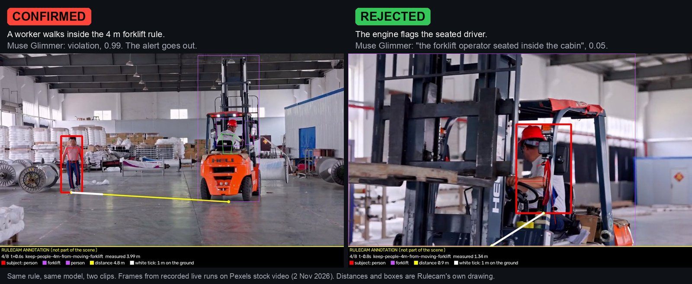

*Same rule, same model, two clips. The rule engine flagged both. Muse Glimmer, Meta's
open-weight model, then running on our own GPU, looked at the frames, confirmed one and rejected
the other. Frames from recorded live runs ([T02 and T04 goldens](scenarios/README.md); the same
verdicts in the [1 Nov live campaign](reports/eval/2026-11-01-live-test-campaign.md)). Since
4 Nov the live site runs this check on Muse Spark 1.3 through the Meta API.*

## Contents

- [Try it now](#try-it-now) · [Screenshots](#screenshots) · [Live now: Meta API only](#live-now-meta-api-only-since-4-nov-2026)
- [One engine, three worlds](#one-engine-three-worlds) · [The platform around them](#the-platform-around-them) · [Why trust it](#why-trust-it)
- [Meta models](#meta-models-what-runs-now-and-what-ran-before) · [How it works](#how-it-works) · [Results](#results) · [Honest limits](#honest-limits)
- More detail: [the problem](#the-problem) · [who it helps](#who-it-helps) · [architecture](#architecture) · [model map](#model-map)
- Run it: [prerequisites](#prerequisites) · [run it on your own machine](#run-it-on-your-own-machine) · [quick start](#quick-start-development) · [usage examples](#usage-examples) · [commands](#commands)
- Build on it: [tech stack](#tech-stack) · [the web UI](#the-web-ui) · [configuration](#configuration) · [API reference](#api-reference) · [tests and builds](#tests-and-builds) · [deployment](#deployment) · [project structure](#project-structure)
- [Troubleshooting and FAQ](#troubleshooting-and-faq) · [Roadmap](#roadmap) · [Contributing](#contributing) · [Licences](#licences)

## Try it now

Live site: **https://rulecam-live.vercel.app**. The site runs on Vercel. During the hackathon the
Rulecam API ran on the team's Mac behind a Cloudflare tunnel, with every model call going to the
Meta API. **Since the hackathon ended (4 Nov 2026) that API is switched off**, so the hosted
site's live pages have no backend. The replay and the verify page below still work, because
they need no API. To run the whole system yourself, see
[Run it on your own machine](#run-it-on-your-own-machine).

| What | Link | What you will see |
|---|---|---|
| The 3-minute video | [`docs/video/script.md`](docs/video/script.md) · [`captions.srt`](docs/video/captions.srt) | The three worlds below, live and recorded, each labelled |
| Replay, no login, no keys | `https://rulecam-live.vercel.app/demo?demo=1` | A recorded live run, step by step: request, plan, Rule CI, runtime, evidence. The header says **REPLAY**. It makes no model calls |
| Check the evidence yourself | `https://rulecam-live.vercel.app/verify/index.html?chain=/golden/warehouse_driver/chain.jsonl&root=6fe7daeb1f2543aef6a3d01d27f3a7793c4516520be41433ba6ee0871f87082e&n=35` | Your browser recomputes every SHA-256 of the 35-record evidence log and checks it against the day's Merkle root. Nothing is trusted from us |
| The three worlds | `https://rulecam-live.vercel.app/usecases/warehouse`, `/usecases/crowd`, `/usecases/supermarket` | Each world's story, step by step, read from what Rulecam recorded. The crowd page shows recorded runs only: crowd is not live now |
| Staff phone app, glasses mode | `https://rulecam-live.vercel.app/staff`, `https://rulecam-live.vercel.app/glasses` | Open them on a phone |
| Run it on your laptop | `./start_rulecam.sh` (macOS/Linux) or `./start_rulecam.ps1` (Windows), then `localhost:3000/demo?demo=1` | The API and the site on your machine; see [Run it on your own machine](#run-it-on-your-own-machine) |

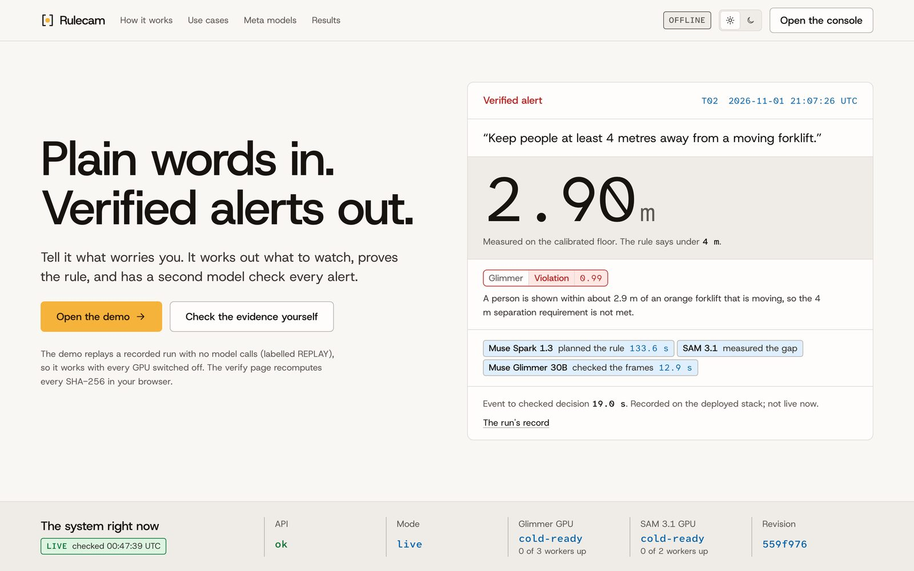

*The landing page, captured before 4 Nov: the recorded T02 run's verified alert, labelled as
recorded, and the state of the stack we ran then. Since 4 Nov the status band names the Meta API
models instead of GPU states.*

## Screenshots

Captured from a local production build of this repository (`npm run build && npm run start`)
with the API in replay mode, so every header says **REPLAY**. What they show is the recorded runs
bundled in the repo; screens built from hand-written examples carry a **SAMPLE DATA** notice, as
they do in the app. Stock and research footage is credited under each image in the app.

| | |
|---|---|
| 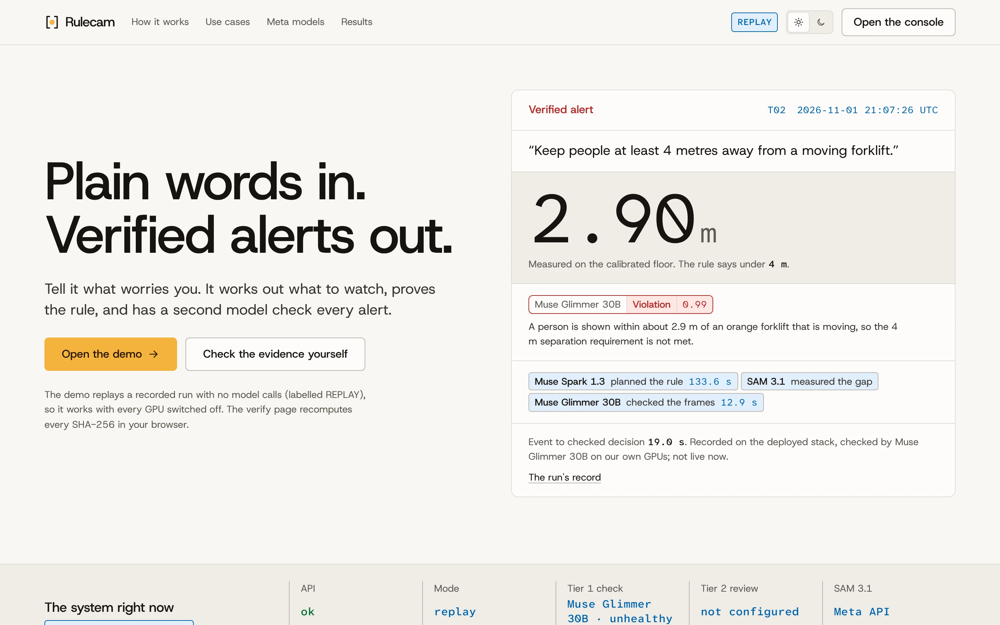 | 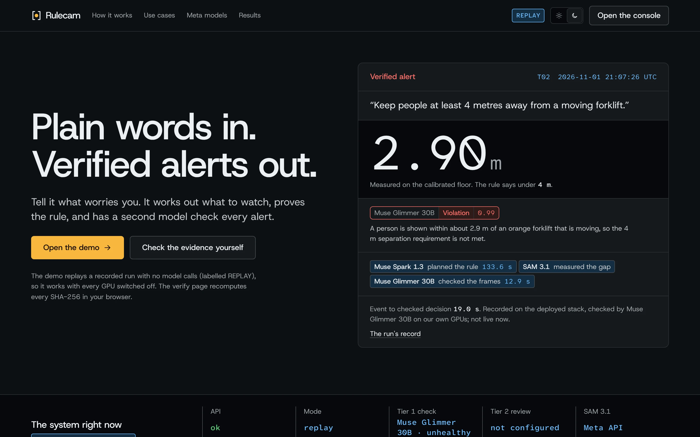 |
| **Landing page**, light theme: the recorded T02 alert with its measured distance and the second model's verdict | **Dark theme**: every screen has both; the choice is remembered, and the system setting is followed until you pick |
| 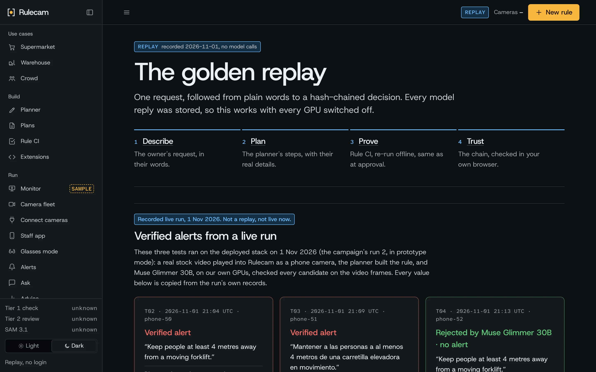 | 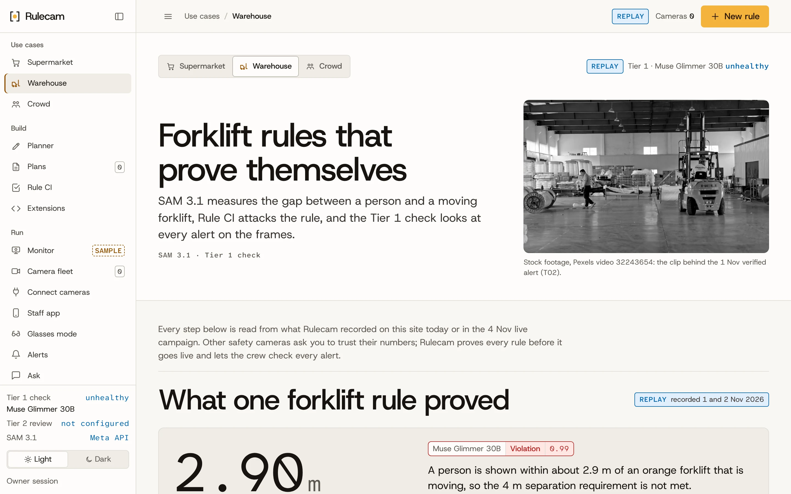 |
| **Golden replay** (`/demo?demo=1`): one request followed from plain words to a hash-chained decision, with no model calls | **Warehouse**: the forklift story, read from what Rulecam recorded |
| 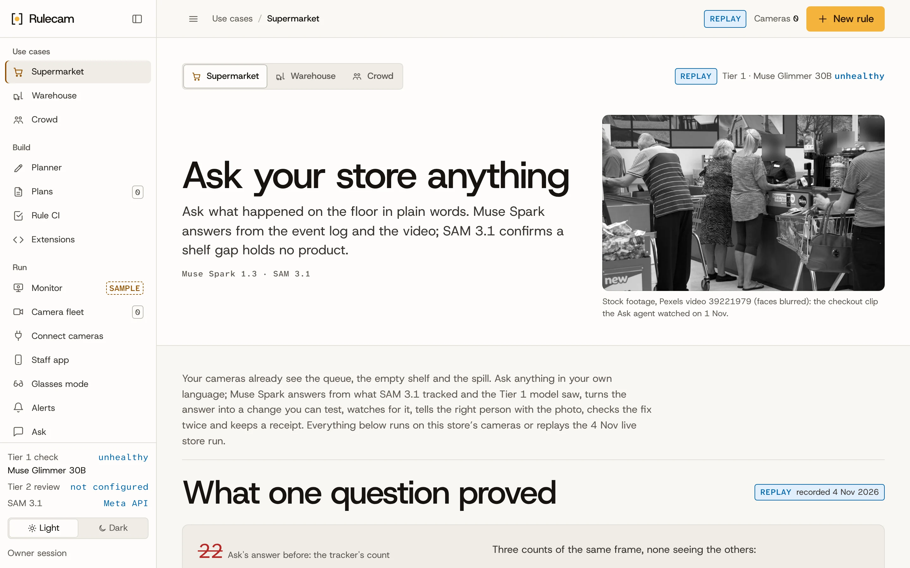 | 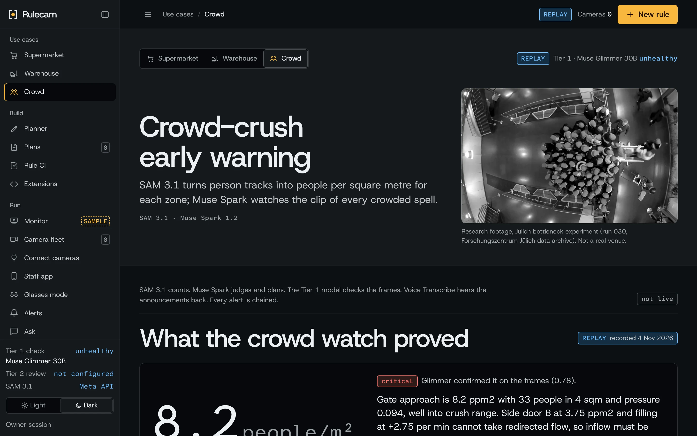 |
| **Supermarket**: Ask, advice, standing watches, staff tasks closed with proof | **Crowd**: zone density from SAM 3.1 counts; recorded runs only (crowd is not live now) |
| 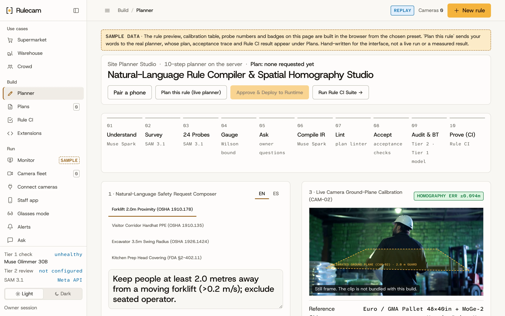 | 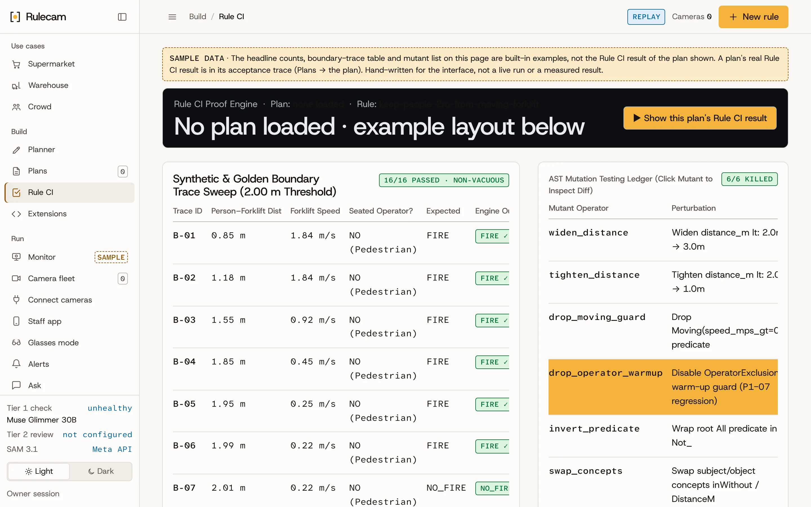 |
| **Planner**: describe a rule; the preview on this screen is labelled SAMPLE | **Rule CI**: boundary scenes and mutants; the example layout is labelled SAMPLE until a plan is loaded |
| 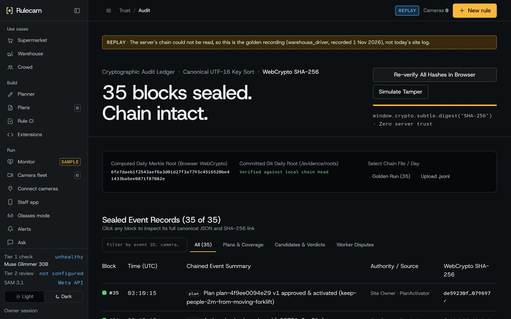 | 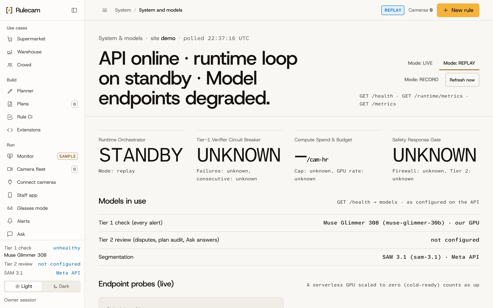 |
| **Audit**: the evidence chain re-hashed in your browser (here the golden recording, as the notice says) | **System and models**: what `/health` and `/runtime/metrics` report, and nothing the API did not say |

On a phone (iPhone 13 size):

| | | | |
|---|---|---|---|
| 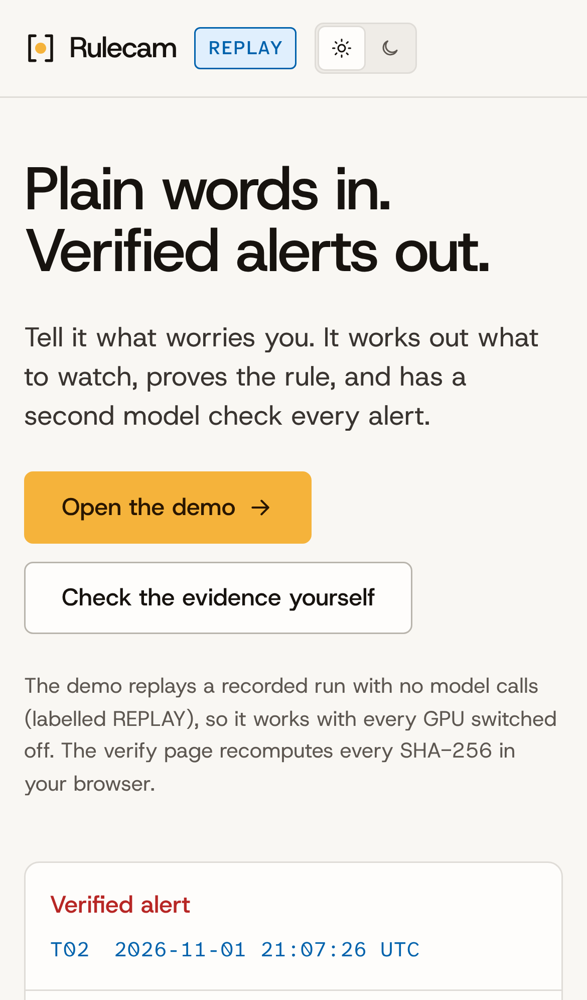 | 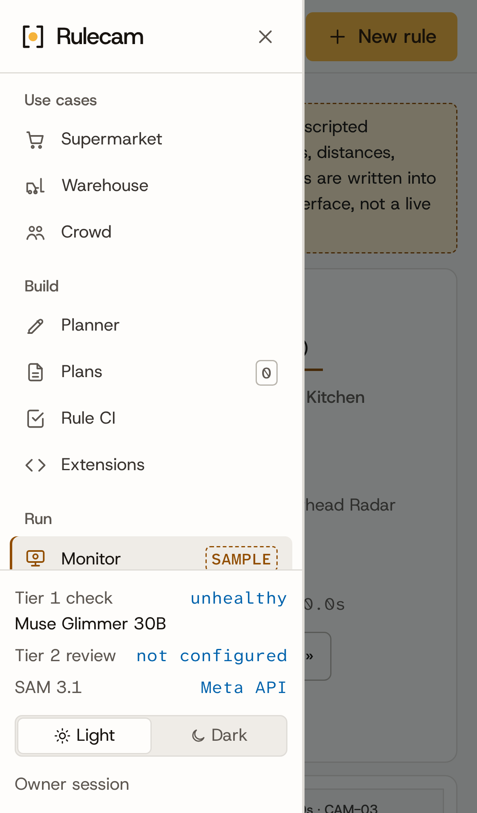 | 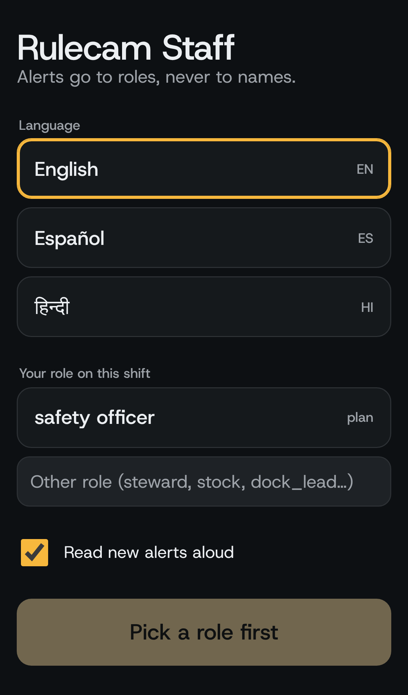 | 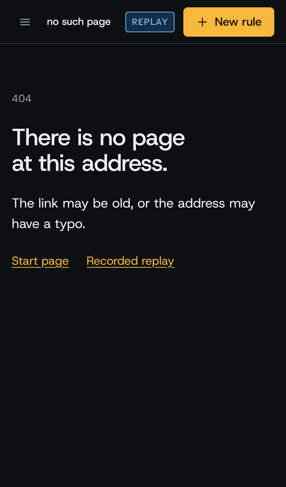 |
| Landing | Navigation drawer (Escape or the backdrop closes it) | Staff app: alerts go to roles, never to names | The 404 page |

## Live now: Meta API only (since 4 Nov 2026)

On 4 Nov, at about 05:50 UTC, we moved every model call to the Meta API. We no longer run
RunPod or any GPUs of our own. Until the hackathon ended, the API and the site ran on the
team's Mac, public through a Cloudflare tunnel ([`docs/deploy.md`](docs/deploy.md), "Meta API
only"). That API is off now; run it yourself with `./start_rulecam.sh`.

- **Runs now:** Muse Spark 1.3 (planner, Ask, the planner's guardrail pass, retail checks, and
  the Tier 1 check of every alert), Muse Wonder 1.0 (Tier 2: dispute review, plan audit, Ask
  answer review), SAM 3.1 hosted by Meta, Muse Voice Transcribe, Muse Image, and Muse Spark 1.2
  where the code uses it (video with narration). Muse Code runs as the local `muse` CLI.
  MMS-TTS voices run on the CPU.
- **Ran before, not now:** Muse Glimmer 30B and Muse Spark Open on our own RunPod GPUs, and
  Llama Guard 4. The planner's own guardrails still decline banned requests (a fixed pattern
  check, then Muse Spark). Prompt Guard 2 is not loaded: the firewall shows "degraded", and
  candidates with text in the scene go to a person.
- **Results from 1–4 Nov** were measured on that earlier stack, with Glimmer on our own GPUs
  and Spark Open on 8 x H100. We keep them and say so wherever we quote them. What we measured
  on the Meta API alone is under [Results](#results).

## One engine, three worlds

One set of parts serves all three: **SAM 3.1** sees and counts, **Muse Spark** plans, reasons
and checks each alert, **Muse Wonder** reviews, and a **hash-chained log** keeps the proof.
Until 4 Nov, **Muse Glimmer** on our own GPUs did the alert check. Each world starts from a
sentence the owner says or types, in their own language.

| World | The owner says | What Rulecam does | Proof |
|---|---|---|---|
| **Warehouse** | "Mantener a las personas a al menos 4 metros de una carretilla elevadora en movimiento." | Plans the rule and says what it can't check. Rule CI attacks it. A second model checks each near miss. Spark writes the warning in Spanish, Meta's MMS-TTS speaks it, and Voice Transcribe listens back to check it was said right. It flags the OSHA refresher training a near miss triggers. A worker can dispute an alert, or report a near miss by voice | **Live now, Meta API only:** the Spanish rule planned in **146 s**, passed Rule CI (**16 of 16** edge cases, **6 of 6** mutants), was approved with two amber caveats ([Results](#results)) and runs on a looped stock clip, with Tier 1 verdicts from Muse Spark 1.3. **Earlier, with Glimmer on our own GPU:** Glimmer confirmed **6 of 6** near misses at **0.98–0.99**; the Spanish warning was heard back with word error **0.09–0.18**, all passed; with the camera already surveyed, a plan took **42–45 s** (**123 s** on a new camera) ([4 Nov](reports/eval/2026-11-04-warehouse-live.md)). The seated driver was rejected at **0.05** ([1 Nov](reports/eval/2026-11-01-live-test-campaign.md)) |
| **Crowd crush early warning** | In Hindi: warn us before the crowd at the main gate turns dangerous; if it fills, send the corridor to side door B | SAM 3.1 counts heads in each zone and turns them into people per m². Spark judges the level, names the crowd's phase and writes steward actions and calm announcements in Hindi and English. Before sending people anywhere, a route guard checks that place is not filling too. A second model checks the frames. A late check never holds back a warning | **Not live now:** the Jülich clips were only on the server we deleted. **Recorded 4 Nov, with Glimmer on our own GPU:** on real footage of the Jülich bottleneck experiment, counts were within **0–4%** of the published truth in every zone, up to 8–9 people per m². With Glimmer warm: confirmed at **0.95** in **6.2 s**, stewards told **26 s** after the reading. Listening back caught a Hindi announcement that came out as "crowd" instead of "gate", so the page did not play it ([report](reports/eval/2026-11-04-crowd-live.md), [chart](docs/pitch/media/crowd-density-vs-truth.png)) |
| **Supermarket** | "When was the checkout queue longest, how many tills were open, … do we need another till?" | Spark picks its own tools: SQL over SAM 3.1 tracks, counts, a model looking at frames, Spark watching the clip. It finds shelf gaps and spills, opens a task for staff, and closes it only when a photo proves the fix. It answers spoken questions in the asker's language | **Live now, Meta API only:** an Ask answer took **57.4 s** (Muse Spark 1.3, SAM 3.1, Muse Wonder review). **Recorded 4 Nov, with Glimmer on our own GPU:** on a busy frame, the tracker said **22** people. Counting the same frame three ways (SAM 3.1, Spark pointing, Glimmer) gave **10**, against about **12** counted by hand. A spill was seen and cleared in **1.9 min**, checked by photo (the spill image is a generated SAMPLE). A spoken Spanish question was heard word for word and answered in Spanish in **45 s** ([report](reports/eval/2026-11-04-supermarket-live.md)) |

Each number is the one we measured, including the weak ones. The limits are
[below](#honest-limits).

## The platform around them

Measured live on 4 Nov, before the move to the Meta API (Glimmer ran on our own GPUs then).

| Piece | What it does | Measured (live, 4 Nov) |
|---|---|---|
| **Connect any camera** | RTSP (H.264, H.265, with a password), HLS, MJPEG, public live streams, uploaded clips and ONVIF discovery. Spark names each camera and says which world it fits | From pressing Connect to a named, surveyed camera: **23–33 s** in every case. No real CCTV device was available: tested against streaming servers and a simulated ONVIF recorder ([report](reports/eval/2026-11-04-connectors.md)) |
| **Staff app** | One feed per role, never per name, in English, Spanish or Hindi. Acknowledge, On my way, Done with a photo, or False alarm. Every tap goes into the chain | A Glimmer-verified alert (0.95) reached Google's push service **8.9 s** after the camera chunk, with the app closed (tested in Chromium, not on a real phone) ([report](reports/eval/2026-11-04-staff-app.md)) |
| **Proof portal** | An inspector or insurer gets a share link to a proof pack. Their browser re-checks every record and every number | **395** records and **97** numbers re-checked in the browser in **0.3–0.4 s**. One edited number turned the page red ([report](reports/eval/2026-11-04-proof-portal.md)) |
| **Glasses mode** | Ask out loud what you are looking at. A model looks (Glimmer then, Muse Spark 1.3 now), SAM 3.1 counts, Spark answers, MMS-TTS speaks | First spoken sentence ready in a median **8.6 s**. Stand-in stills and a phone page: not yet run on real glasses ([report](reports/eval/2026-11-04-glasses.md)) |
| **Muse Code rule types** | For a rule the engine can't express, Muse Code writes the check. Rulecam tests it and the Z3 solver proves it | "Alert if a pallet is stacked above the yellow line": Z3 proved **4 of 4** properties, mutation testing caught **25 of 26** broken copies, the owner approved it on the live API, and it ran on a real clip ([report](reports/eval/2026-11-04-muse-code-live.md)) |
| **Chain Mode** | One rule pack for many stores, proved at every allowed setting, with a store-level scorecard (never per worker) | The pack's Rule CI is real; the store scorecard is **SIMULATED** and labelled so ([report](reports/eval/2026-11-04-chain-mode-demo.md)) |

## Why trust it

Other products already let you search or set camera alerts in plain words (Verkada, Hakimo,
Spot AI, Brivo, Conntour). Rulecam's difference is **proof**:

1. **It says what it can't see.** Before a rule goes live, the planner probes the camera and
   reports what it can and can't check. Asked to keep people away from a forklift on a kitchen
   camera, it said "I can't see the forklift reliably (lower bound 0.00)"
   ([T08](reports/eval/2026-11-01-live-test-campaign.md)).
2. **Rule CI proves each rule first.** Like tests for code: it attacks the rule with edge
   cases and broken copies of itself (mutants). Every forklift plan on 4 Nov passed **16 of 16**
   edge cases and caught **6 of 6** mutants.
3. **Every alert is checked, and checks are checked.** A second model looks at the frames
   before anyone is told, and it can say no: Muse Spark 1.3 now, Muse Glimmer on our own GPUs
   before 4 Nov. Muse Wonder 1.0 can give a second opinion (Muse Spark Open did before). Counts
   are made three ways when it matters. Spoken warnings are heard back before they play.
4. **Evidence anyone can verify.** Every event, verdict, action and staff tap goes into a
   hash-chained log with a daily Merkle root (one fingerprint for the whole day). Your browser
   can recompute it, and an inspector gets the same check through the proof portal.
5. **Workers have a voice.** Every rule is on a QR poster page. Anyone can dispute an alert or
   report a near miss by voice. On 4 Nov a worker's dispute was upheld, and it became a
   permanent Rule CI test (it also exposed a bug in how the evidence ruler was drawn, now fixed).
6. **Privacy.** No face recognition, ever. Alerts go to roles, never to names. The planner's
   guardrails refuse rules about who people are (Llama Guard 4 also screened them before 4 Nov).
   Faces are blurred in evidence by default. Since 4 Nov every model call, the alert checks
   included, goes to the Meta API; before that, Glimmer and Spark Open ran on open weights on our
   own GPUs. Our Meta API key is set to the Standard tier, never the Contributor tier, under
   which Meta may train on inputs ([`.env.example`](.env.example)). Every measured run used
   public footage or labelled SAMPLE images, never a real site's CCTV.
7. **Cameras you already own.** RTSP, HLS, MJPEG, ONVIF, a phone paired by QR code, or a public
   stream.
8. **Any language.** A Spanish rule, a Hindi instruction, spoken questions answered in the
   asker's language, and staff feeds in English, Spanish or Hindi.

## Meta models: what runs now, and what ran before

**Now** is the live system since 4 Nov 2026 (about 05:50 UTC): every call goes to the Meta API,
from the API on the team's Mac. **Before** is how the model ran in the recorded runs of 1–4 Nov.
Several 4 Nov runs used a laptop running the API against the live models rather than the
deployed pod; each report says where it ran.

| Model | Its job in Rulecam | Now | Before 4 Nov |
|---|---|---|---|
| **Muse Spark 1.3** | Plans and compiles rules; the planner's guardrail pass; runs the Ask agent's tool loop; retail checks (queues, shelf gaps, spills); judges crowd levels and plans routes; reviews worker disputes when no Tier 2 answers; web search where every kept item must cite a page the search returned. **Since 4 Nov also the Tier 1 check of every alert**, through the client Glimmer used | **Live**, Meta API | Meta API, everything but the Tier 1 check |
| **Muse Spark 1.2** | Watches a recorded clip as video, with narration | **Live** where the code uses it, Meta API | Meta API |
| **Muse Wonder 1.0** | Tier 2: second check on alerts, dispute review, plan audit, review of Ask answers, through the client Spark Open used | **Live**, Meta API | Not used |
| **SAM 3.1** | Surveys the scene, probes what the camera can detect, tracks people and objects, counts heads, confirms gaps and spills | **Live**, hosted by Meta | Hosted by Meta, and self-hosted on our RunPod serverless GPUs for runtime keyframes |
| **Muse Code** | Writes the code for new rule types; the Z3 solver then proves four properties or returns a counterexample | **Live** as the local `muse` CLI | From a laptop with the CLI; the API pod had no CLI, so there Spark 1.3 wrote the check, labelled as such |
| **Muse Voice Transcribe** | Spoken rules, questions, disputes and near-miss reports; hears every spoken warning back | **Live**, Meta API | Meta API |
| **Muse Image** | Test images when no real footage exists (the spill, the restocked shelf, the blocked exit), toolbox-talk drawings | **Live**, Meta API; every generated image is labelled SAMPLE. The Rule CI scenes step is still skipped | Meta API |
| **MMS-TTS** (Meta FAIR) | Speaks warnings and announcements in the listener's language | **Live**, on the CPU | CPU |
| **Muse Glimmer 30B** (open weights) | Checked every alert; counted for the three-way count; translated each rule back into plain words; looked for Ask and glasses mode | Not running. Its client now calls Muse Spark 1.3 | llama-server on our own serverless GPUs, with a standby endpoint in a second region and a hosted fallback |
| **Muse Spark Open** (open weights) | Second check on alerts (Tier 2), plan audit, review of Ask answers | Not running. Its client now calls Muse Wonder 1.0 | Self-hosted on our own 8 x H100 serverless endpoint: $43.12 an hour warm and about 18 minutes to start, so it was warmed for demos |
| **Llama Guard 4** | Screened each request before planning and refused rules about who people are | Not running. The planner's own guardrails still decline banned requests: a fixed pattern check, then Muse Spark | On our own serverless GPU (vLLM) |
| **Llama Prompt Guard 2** | Firewall for text found in the scene (a sign saying "ignore the rules") | Not loaded: the firewall shows "degraded", and candidates with scene text go to a person | On the API pod's CPU |
| **DINOv2** (Meta FAIR) | Joined an object's track pieces into one identity for Ask | Not running (it ran on our SAM GPU) | On our SAM GPU, prototype mode only |

The full map, with where each model runs, is in [Model map](#model-map).

## How it works

1. **Describe.** The owner types or says a concern, in any language. The planner's guardrails
   screen it. Muse Spark turns it into a plan: what to watch, on which camera, and what a camera
   cannot check.
2. **Plan.** SAM 3.1 surveys the scene and probes how often it can see what the rule needs.
   The planner measures metres on the floor, then writes the rule in a typed rule language
   (Rule IR) that a rule engine runs. A model reads the rule back in plain words.
3. **Prove.** Rule CI attacks the rule. A person approves the plan with every check on screen.
4. **Watch.** The camera sends 3-second video chunks. SAM 3.1 finds people and objects (hosted
   by Meta since 4 Nov; on our own GPU before), a tracker follows them, and the rule engine
   checks the rule on every keyframe.
5. **Check.** When the rule fires, a second model (Muse Spark 1.3 since 4 Nov; Muse Glimmer
   before) looks at a strip of frames and says yes, no or unsure. A safety-first policy decides
   what happens next.
6. **Act and record.** The alert goes to a role on the staff app, Telegram, WhatsApp or a
   webhook; a warning is spoken and heard back. Every step, and every staff tap, goes into the
   hash-chained log.

## Results

### On the Meta API alone (4 Nov, after the switch)

Measured live on 4 Nov after the move to the Meta API. The model proofs are from
`scripts/ops/model_proofs.py` (also in the message of commit `1d98493`); the rest are from the
live API that day. They are not yet written up in [`reports/eval/`](reports/eval/).

| Measured | Value |
|---|---|
| Model proofs, Tier 1 on a warehouse strip (Muse Spark 1.3) | 9.8 s, violation at p = 0.97, passed |
| Model proofs, Tier 2 (Muse Wonder 1.0) / plan audit / Ask answer review | 6.1 s / 19.9 s / 7.7 s, all passed |
| Warehouse: the Spanish 4 m forklift rule, request to plan | 146 s (survey 50.6, probe 59.8, gauge 6.0, ask 10.3, compile 0.2, audit 19.2, prove 0.1) |
| Warehouse: Rule CI on that plan | boundary 16 of 16, mutants 6 of 6 |
| Warehouse: approval | approved amber: forklift detection lower bound 0.797 against the 0.80 bar; calibration error 0.20 m against the 0.10 m limit |
| Warehouse: running live | on a looped Pexels clip, Tier 1 verdicts from `muse-spark-1.3` |
| Warehouse: verify chain, Tier 1 + Tier 2 | 11.3 s |
| Supermarket: one Ask answer (Muse Spark 1.3, SAM 3.1, Muse Wonder 1.0 review) | 57.4 s |
| Supermarket: queue check / hazard check on CAVIAR corridor clips | 18.6 s / 7.4 s. Spark reported that the corridor has no checkout tills |
| Crowd | not live now: the Jülich clips were only on the server we deleted |

### Earlier: 1–4 Nov, with Glimmer on our own GPUs

Headline numbers from the 4 Nov live runs, measured before the move to the Meta API, with Muse
Glimmer 30B on our own RunPod GPUs (each from the report it links):

| Measured | Value | Source |
|---|---|---|
| Glimmer on live forklift near misses (our GPU, runs 5–7) | 6 of 6 confirmed, 0.98–0.99 | [warehouse](reports/eval/2026-11-04-warehouse-live.md) |
| Spanish warning heard back by Voice Transcribe | word error 0.09, 0.15, 0.18: all passed | [warehouse](reports/eval/2026-11-04-warehouse-live.md) |
| Request to plan, camera already surveyed / new camera | 41.8 s and 45.1 s / 122.8 s | [warehouse](reports/eval/2026-11-04-warehouse-live.md) |
| Crowd counts against the Jülich truth, every zone and run | within 0–4% (mean error 0.6–1.6 people) | [crowd](reports/eval/2026-11-04-crowd-live.md) |
| Crowd reading to stewards told, Glimmer warm (run 6) | 26 s (Glimmer confirmed 0.95 in 6.2 s) | [crowd](reports/eval/2026-11-04-crowd-live.md) |
| Three-way count of the hottest zone, mean error | SAM 3.1 0.8, Glimmer 0.8, Spark 2.0 people | [crowd](reports/eval/2026-11-04-crowd-live.md) |
| Ask's count on a busy checkout frame, before / after the three-way count / by hand | 22 / 10 / about 12 | [supermarket](reports/eval/2026-11-04-supermarket-live.md) |
| Spill (generated SAMPLE image) seen to cleared, checked by photo | 1.9 min | [supermarket](reports/eval/2026-11-04-supermarket-live.md) |
| Camera connected to named and surveyed | 23–33 s | [connectors](reports/eval/2026-11-04-connectors.md) |
| Verified alert to Google's push service, app closed | 8.9 s from the camera chunk | [staff app](reports/eval/2026-11-04-staff-app.md) |
| Proof pack re-checked in the browser | 395 records, 97 numbers, 0.3–0.4 s | [proof portal](reports/eval/2026-11-04-proof-portal.md) |
| Glasses mode, first spoken sentence | median 8.6 s | [glasses](reports/eval/2026-11-04-glasses.md) |
| Muse Code rule type: Z3 proof, mutants caught | 4 of 4, 25 of 26 | [Muse Code](reports/eval/2026-11-04-muse-code-live.md) |

The table below is generated from the result files of the 1–3 Nov runs. Those runs also used
the earlier stack: SAM 3.1 and Glimmer on our own GPUs.

<!-- BEGIN RESULTS (generated by `uv run rulecam eval results`; do not edit) -->

Measured on the deployed stack and on public hand-labelled footage. Each row is read from the result file it cites by `uv run rulecam eval results`, with its run, date and the commit that recorded it; a test fails if a number here is not in that file. Weak results are shown as measured. The verifier is not yet scored against human labels (the blind labelling kit is in `eval/README.md`); more in [`eval/RESULTS.md`](eval/RESULTS.md).

| Measured | Value | Run | Date | Git SHA | Source |
|---|---|---|---|---|---|
| Distance measured, worker passing a moving forklift | 2.90 m | live test campaign, run 2: T02 | 2026-11-01 | `87d6cea` | [`2026-11-01-live-test-campaign.json`](reports/eval/2026-11-01-live-test-campaign.json) |
| Glimmer P(violation), worker inside the 4 m rule (verified alert) | 0.99 | live test campaign, run 2: T02 | 2026-11-01 | `87d6cea` | [`2026-11-01-live-test-campaign.json`](reports/eval/2026-11-01-live-test-campaign.json) |
| Event to verified decision | 19.0 s | live test campaign, run 2: T02 | 2026-11-01 | `87d6cea` | [`2026-11-01-live-test-campaign.json`](reports/eval/2026-11-01-live-test-campaign.json) |
| Glimmer P(violation), same rule asked in Spanish (warning queued in Spanish) | 0.98 | live test campaign, run 2: T03 | 2026-11-01 | `87d6cea` | [`2026-11-01-live-test-campaign.json`](reports/eval/2026-11-01-live-test-campaign.json) |
| Glimmer P(violation), seated driver flagged by the engine (rejected, no alert) | 0.05 | live test campaign, run 2: T04 | 2026-11-01 | `87d6cea` | [`2026-11-01-live-test-campaign.json`](reports/eval/2026-11-01-live-test-campaign.json) |
| Request to plan ready (planner, live models) | 133.6 s | live test campaign, run 2: T02 | 2026-11-01 | `87d6cea` | [`2026-11-01-live-test-campaign.json`](reports/eval/2026-11-01-live-test-campaign.json) |
| SAM 3.1 per 3 s chunk, p95 (self-hosted GPU) | 2.07 s | live test campaign, run 2: T02 | 2026-11-01 | `87d6cea` | [`2026-11-01-live-test-campaign.json`](reports/eval/2026-11-01-live-test-campaign.json) |
| Seconds with the exact people count (real CCTV, hand labels) | 22.7% | CAVIAR corridor, phone-68 | 2026-11-02 | `87d6cea` | [`2026-11-02-corridor-ground-truth.json`](reports/eval/2026-11-02-corridor-ground-truth.json) |
| Seconds with the count within one person | 53.4% | CAVIAR corridor, phone-68 | 2026-11-02 | `87d6cea` | [`2026-11-02-corridor-ground-truth.json`](reports/eval/2026-11-02-corridor-ground-truth.json) |
| Peak people at once, system vs labels | 10 vs 8 | CAVIAR corridor, phone-68 | 2026-11-02 | `87d6cea` | [`2026-11-02-corridor-ground-truth.json`](reports/eval/2026-11-02-corridor-ground-truth.json) |
| Person tracks and identities vs labelled visits | 416 tracks, 39 identities vs 80 visits | CAVIAR corridor, phone-68 | 2026-11-02 | `87d6cea` | [`2026-11-02-corridor-ground-truth.json`](reports/eval/2026-11-02-corridor-ground-truth.json) |
| Backfill of recorded chunks (tracked points in seconds) | 5301 points in 409 s | CAVIAR corridor, phone-68 | 2026-11-02 | `87d6cea` | [`2026-11-02-corridor-ground-truth.json`](reports/eval/2026-11-02-corridor-ground-truth.json) |
| Glimmer decisive before the strip renderer existed | 0 of 10 candidates | first recorded run (warehouse driver only) | 2026-10-31 | `79bd84a` | [`2026-10-31.json`](reports/eval/2026-10-31.json) |
| Person tracking, HOTA / IDF1 vs CAVIAR labels: ByteTrack, SAM detections at 0.5 and up | 0.239 / 0.240 | CAVIAR corridor tracks, morning backfill (ByteTrack) | 2026-11-02 | `1786ad2` | [`2026-11-02-corridor-tracking-before.json`](reports/eval/2026-11-02-corridor-tracking-before.json) |
| ID switches per minute, same run | 19.6 | CAVIAR corridor tracks, morning backfill (ByteTrack) | 2026-11-02 | `1786ad2` | [`2026-11-02-corridor-tracking-before.json`](reports/eval/2026-11-02-corridor-tracking-before.json) |
| Person tracking, HOTA / IDF1, same footage: ByteTrack with SAM detections down to 0.1 | 0.223 / 0.217 | CAVIAR corridor tracks, re-tracked with ByteTrack at the 0.1 floor (add-on 2.1) | 2026-11-02 | `1786ad2` | [`2026-11-02-corridor-tracking-bytetrack.json`](reports/eval/2026-11-02-corridor-tracking-bytetrack.json) |
| ID switches per minute, same run | 21.2 | CAVIAR corridor tracks, re-tracked with ByteTrack at the 0.1 floor (add-on 2.1) | 2026-11-02 | `1786ad2` | [`2026-11-02-corridor-tracking-bytetrack.json`](reports/eval/2026-11-02-corridor-tracking-bytetrack.json) |
| Our HOTA vs TrackEval's on the same segment (scorer cross-check) | 0.2603 vs 0.2603 | CAVIAR TwoEnterShop1cor, our scorer vs TrackEval | 2026-11-02 | `1786ad2` | [`2026-11-02-trackeval-crosscheck.json`](reports/eval/2026-11-02-trackeval-crosscheck.json) |
| Same strips replayed (8 raw frames at 960 px), verdicts matching the 1 Nov ones | 27 of 29 | Glimmer replay of the 1 Nov campaign strips | 2026-11-02 | `8bb65e3` | [`2026-11-02-verifier-replay-summary.json`](reports/eval/2026-11-02-verifier-replay-summary.json) |
| Decisive verdicts that flip with 6 face-blurred frames at 640 px instead | 6 of 29 | Glimmer replay of the 1 Nov campaign strips | 2026-11-02 | `8bb65e3` | [`2026-11-02-verifier-replay-summary.json`](reports/eval/2026-11-02-verifier-replay-summary.json) |
| Glimmer median per strip, 8 raw at 960 px vs 6 blurred at 640 px | 10898 ms vs 8505 ms | Glimmer replay of the 1 Nov campaign strips | 2026-11-02 | `8bb65e3` | [`2026-11-02-verifier-replay-summary.json`](reports/eval/2026-11-02-verifier-replay-summary.json) |
| Verdicts unchanged with a reasoning budget of 0 tokens (llama.cpp ignores the budget; reasoning stays short) | 20 of 20 | Glimmer reasoning-budget sweep | 2026-11-02 | `1786ad2` | [`2026-11-02-glimmer-budget-sweep.json`](reports/eval/2026-11-02-glimmer-budget-sweep.json) |
| Fights, "Alert me if people start fighting": found, missed, false alerts | 0 found, 4 missed, 0 false alerts | CAVIAR lobby clips (384x288, overhead), live rule runs | 2026-11-02 | `1786ad2` | [`2026-11-02-caviar-inria-events.json`](reports/eval/2026-11-02-caviar-inria-events.json) |
| Fight candidates on Fight_Chase, every one rejected by Glimmer as no visible fight | 8 candidates, 0 alerts | CAVIAR lobby clips (384x288, overhead), live rule runs | 2026-11-02 | `1786ad2` | [`2026-11-02-caviar-inria-events.json`](reports/eval/2026-11-02-caviar-inria-events.json) |
| Falls, "Tell me if anyone falls down": found, missed, false alerts | 0 found, 2 missed, 0 false alerts | CAVIAR lobby clips (384x288, overhead), live rule runs | 2026-11-02 | `1786ad2` | [`2026-11-02-caviar-inria-events.json`](reports/eval/2026-11-02-caviar-inria-events.json) |
| Left bags and boxes: found, missed, false alerts | 0 found, 3 missed, 0 false alerts | CAVIAR lobby clips (384x288, overhead), live rule runs | 2026-11-02 | `1786ad2` | [`2026-11-02-caviar-inria-events.json`](reports/eval/2026-11-02-caviar-inria-events.json) |
| Shop entries, "Let me know each time someone walks into one of the shops": found, missed, false alerts | 0 found, 19 missed, 0 false alerts | CAVIAR corridor clips, live rule runs | 2026-11-02 | `1786ad2` | [`2026-11-02-caviar-corridor-events.json`](reports/eval/2026-11-02-caviar-corridor-events.json) |
| One alert check on warm GPUs (SAM 3.1 on a 3 s chunk, then Glimmer on its strip), total | 28.7 s | Serverless load test (SAM chunk + Glimmer strip per check) | 2026-11-02 | `1786ad2` | [`2026-11-02-serverless-load.json`](reports/eval/2026-11-02-serverless-load.json) |
| 20 alert checks at once on warm GPUs, total p50 / p95 | 36.0 s / 51.9 s | Serverless load test (SAM chunk + Glimmer strip per check) | 2026-11-02 | `1786ad2` | [`2026-11-02-serverless-load.json`](reports/eval/2026-11-02-serverless-load.json) |
| GPU cost per alert check, 20 at once (RunPod serverless, billed worker time) | $0.0039 | Serverless load test (SAM chunk + Glimmer strip per check) | 2026-11-02 | `1786ad2` | [`2026-11-02-serverless-load.json`](reports/eval/2026-11-02-serverless-load.json) |
| Checks answered within 300 s after SAM scaled to zero (1 and 5 at once; Glimmer stayed warm) | 0 of 1, 4 of 5 | Serverless load test (SAM chunk + Glimmer strip per check) | 2026-11-02 | `1786ad2` | [`2026-11-02-serverless-load.json`](reports/eval/2026-11-02-serverless-load.json) |
| Ask's graded numbers within tolerance of the hand labels | 7 of 36 | Ask benchmark, CAVIAR corridor, 10 questions x 3 runs (`rulecam eval ask`) | 2026-11-02 | `1786ad2` | [`2026-11-02T230520Z-corridor.json`](reports/eval/ask/2026-11-02T230520Z-corridor.json) |
| Ask's median answer time | 41.8 s | Ask benchmark, CAVIAR corridor, 10 questions x 3 runs (`rulecam eval ask`) | 2026-11-02 | `1786ad2` | [`2026-11-02T230520Z-corridor.json`](reports/eval/ask/2026-11-02T230520Z-corridor.json) |
| "How many went into a shop?" (truth: 24), the three runs' answers | 14, 11, 32 | Ask benchmark, CAVIAR corridor, 10 questions x 3 runs (`rulecam eval ask`) | 2026-11-02 | `1786ad2` | [`2026-11-02T230520Z-corridor.json`](reports/eval/ask/2026-11-02T230520Z-corridor.json) |
| MOT17 HOTA by TrackEval, lowest (MOT17-13) and highest (MOT17-04) sequence; keyframes only, so not directly comparable with published trackers | 0.203 to 0.450 | MOT17 training set, 7 sequences, SAM 3.1 keyframes at 10 per second + ByteTrack (0.1 floor) | 2026-11-03 | `1786ad2` | [`2026-11-02-mot17.json`](reports/eval/2026-11-02-mot17.json) |

<!-- END RESULTS -->

An earlier E3 figure came from a simulated harness and was withdrawn on Oct 31 (see
[`eval/RESULTS.md`](eval/RESULTS.md)).

## Honest limits

- **The live site is one Mac.** The API and the site run on the team's Mac through a Cloudflare
  tunnel. If the Mac or the tunnel stops, the live pages stop; if the tunnel restarts, the
  address changes. The replay also runs offline (`cd ui && npm ci && npm run dev`).
- **Most results come from the earlier stack.** The 1–4 Nov results were measured with Glimmer
  on our own GPUs (and Spark Open on 8 x H100 where a run used it), before the move to the Meta
  API. On the Meta API alone we have the numbers [above](#on-the-meta-api-alone-4-nov-after-the-switch),
  not yet a full re-run.
- **Not running now:** Llama Guard 4 (the planner's own guardrails still decline banned
  requests) and Prompt Guard 2 (the firewall shows "degraded"; candidates with scene text go to
  a person). **Crowd is not live now**: the Jülich clips were only on the server we deleted, so
  its results are recorded results.
- **Many 4 Nov runs were on a laptop**, running the API against the live models, not on the
  deployed pod. Each report says where it ran.
- **GPU capacity decided the speed before 4 Nov.** When the serverless SAM pool was throttled, a
  camera chunk took about 123 s to become a candidate; warm, about 2 s. Spark Open needed about
  18 minutes to start.
- **Glimmer once held a true crowd alert.** In crowd run 5 it described a crush-level crowd but
  answered "not confirmed" (0.68). Now Spark decides to send or hold when the Tier 1 check
  disagrees; that path is unit-tested but has not come up live yet.
- **Counts from tracks are high on busy views**, and Ask's counts were weak on hand-labelled
  CCTV (7 of 36 within tolerance, 2 Nov). The three-way count fixes the busy-frame case it was
  tested on, not every case.
- **Some footage is generated.** The spill, the restocked shelf and the blocked fire exit are
  Muse Image edits, labelled SAMPLE. Chain Mode's scorecard is SIMULATED.
- **Not tested on real hardware:** a real CCTV camera or NVR, real glasses, a real phone for
  push notifications, a real speaker.
- **Low-resolution overhead footage beats some rules.** On CAVIAR clips (384x288) shop entries,
  fights, falls and left bags were all missed, with no false alerts.
- **Prototype mode is on in the hackathon deployment.** See
  [What we claim, and what we don't](#what-we-claim-and-what-we-dont).
- **Rulecam is not a safety system of record.** It helps people watch. It does not replace a
  guard, a lock-out or a supervisor.

---

## More detail

### The problem

- **Cameras are everywhere, but nobody is watching.** One retailer found that less than 1% of
  its recorded video is ever viewed
  ([Security Magazine](https://www.securitymagazine.com/articles/76977-so-why-isnt-shrink-shrinking-1)).
  A small site has cameras, but no safety team to watch them, write rules for them, or check
  that an alert is real.
- **Forklifts hurt people every day.** OSHA counts about **85 deaths and 34,900 serious
  injuries a year** from forklifts in the US
  ([OSHA, Powered Industrial Trucks notice](https://www.osha.gov/sites/default/files/enforcement/directives/reg1_fy2018_cpl-04-00-023e_powered-industrial-trucks.pdf)).
  One in four blue-collar workers saw a near miss in the past year and didn't report it
  ([TRADESAFE survey](https://trdsf.com/blogs/news/workplace-safety-silence-reporting-risks)).
- **Language matters.** In 2024 Hispanic or Latino workers died at work at 4.3 per 100,000
  full-time workers, against 3.3 for all workers
  ([BLS](https://www.bls.gov/news.release/cfoi.nr0.htm)). OSHA requires training in a language
  workers understand.
- **Empty shelves and queues cost sales.** Out-of-stocks cost about 7.4% of retail sales in
  2021, per NielsenIQ data
  ([report](https://a-closer-look.com/wp-content/uploads/2024/09/Report-Out-of-Sight-Out-of-Mind-The-Hidden-Cost-of-Empty-Shelves-and-Broken-Displays_FINAL-sm.pdf)).
- **Crowds get dangerous before anyone can see it from the ground.** In a crush, nobody does
  anything wrong. People are packed so tightly that they can no longer move by choice. Inquiries
  keep finding the same thing: the warning existed, and it did not become action
  ([our research, with sources](docs/pitch/research/crowd.md#what-repeats)). A camera looking
  down can count, and an alert can name who does what next.
- **Trust is the gap.** Plain-language camera alerts already exist. What owners, workers and
  insurers can't get is a way to check that a rule works and an alert is real
  ([market research](docs/pitch/research/)).

### Who it helps

- **A small warehouse** with forklifts and no safety officer.
- **A supermarket owner** who wants to know about queues, empty shelves and busy hours, across
  one store or many.
- **A venue, station or festival** that wants a warning before the crowd at a gate gets too
  dense.
- **The crew.** They see every rule on a QR poster page, can dispute an alert with one tap, and
  are never recognised by face.

### For judges: the 2-minute path

| Time | Open | What to look for |
|---|---|---|
| 0:00 | `https://rulecam-live.vercel.app/demo?demo=1` | The owner's plain-language request, the planner's steps, the compiled rule and its acceptance trace |
| 0:30 | the Rule CI section of the same page | The rule was attacked with boundary scenes and mutants before anyone could approve it, re-run offline in CI |
| 0:50 | **Verify it in your browser** | Your browser recomputes every SHA-256 of the evidence chain and its Merkle root |
| 1:20 | [Results](#results), then [`reports/eval/`](reports/eval/) | Live runs on real video and on hand-labelled CCTV, every number tied to its run, date and commit |
| 1:45 | [Model map](#model-map) | Which Meta model does which job, and where it runs |

> **Built during the hackathon.** Everything in this repository was written between Oct 26 and
> Nov 4 2026. [`WHAT-WE-BUILT.md`](WHAT-WE-BUILT.md) lists every module with the pull request
> that added it, and every reused library or model with its licence.

### How we use Meta models, beyond a basic call

- **Muse Spark is an agent with a fixed set of steps.** It turns a sentence into a plan, asks
  clarifying questions, grounds each rule in a standard (OSHA, FDA Food Code), and compiles it
  into Rule IR: survey, probe, calibrate, compile, check, repair.
- **Muse Spark answers questions about what the cameras saw.** The Ask agent runs a tool loop:
  SQL over SAM 3.1 tracks, SAM 3.1 counts on recorded frames, a model looking at frames with
  numbered boxes (Glimmer before 4 Nov), and Spark 1.2 watching the recorded clip as video.
- **Muse Spark searches the web, and we check every source.** For site context (weather,
  events, food recalls) an item is kept only if its source is a page the search really
  returned ([site tools report](reports/eval/2026-11-03-site-tools-live.md)).
- **Muse Spark and SAM 3.1 check each other.** On shelves, Spark proposes empty facings and SAM
  3.1 confirms no product package is inside each one. In crowds, SAM counts and Spark judges.
- **Three counts of the same frame.** SAM 3.1 boxes, Spark pointing at each person on a
  0–1000 grid, and a third count through the client Glimmer used, none seeing the others; Spark
  reconciles them and says why. On a busy checkout frame on 4 Nov, with Glimmer on our own GPU
  making the third count, this moved Ask's answer from 22 to 10 (about 12 by hand).
- **Speech is checked by listening.** Spark writes a warning or announcement, MMS-TTS speaks it,
  Voice Transcribe hears it back, and Spark judges whether the meaning survived. It caught a
  Hindi announcement that came out as "crowd" instead of "gate".
- **Spark plans routes and a guard checks them.** Before Spark sends a crowd anywhere, the
  route guard reads that place's camera; when side door B was already filling, Spark changed
  its plan to hold the inflow instead.
- **The Tier 1 check: Glimmer before, Muse Spark 1.3 now.** The Tier 1 client also translates each rule
  back into plain words, so the owner can check it says what they meant. Until 4 Nov it called
  Muse Glimmer, open weights, in llama-server on RunPod serverless GPUs behind a load balancer
  we built, with a standby in a second region. Since 4 Nov the same client calls Muse Spark 1.3
  on the Meta API, which speaks the same OpenAI chat format.
- **The Tier 2 check: Spark Open before, Muse Wonder 1.0 now.** Until 4 Nov Muse Spark Open, open weights on our own 8 x H100, did the
  Tier 2 check, the plan audit and the review of Ask's answers. Since 4 Nov the same client calls
  Muse Wonder 1.0 on the Meta API.
- **Banned requests are declined before planning.** The planner's guardrails (a fixed pattern
  check, then Muse Spark) refuse rules about who people are. Until 4 Nov Llama Guard 4 screened
  each request too.
- **Muse Code writes code, and a solver proves it.** For a rule type the engine does not have,
  Muse Code writes a check. Rulecam runs it in a sandbox, tests it on generated scenes and
  broken copies, and has the Z3 solver prove four properties for every valid scene up to a set
  number of objects (2 in the 4 Nov run): no alert without the target object, never crashes,
  moving the whole image changes nothing, and a declared move never turns an alert off. Anything
  it cannot prove exactly is marked unsupported, never proved. On 4 Nov Z3 found a real bug
  in one version (a vertical line divided by zero), and the repair round fixed it.

### What it does, step by step

1. **Describe it.** The owner types or says what worries them. Muse Spark plans the job: what
   to watch, which camera covers it, and what a camera *cannot* check. The feasibility screen
   says so before anything goes live.
2. **Plan it.** The planner looks at the scene with SAM 3.1, measures real distances, and
   writes the rule in Rule IR. It shows the plan, what changed since the last approved plan,
   and every check it passed.
3. **Prove it.** Rule CI attacks every rule with edge-case scenes and mutants before the owner
   can approve it. By default, a rule that fails Rule CI cannot go live. In prototype mode (on
   in the hackathon deployment) a failed check is shown as an amber caveat instead.
4. **Trust it.** Before anyone is alerted, a second model (Muse Spark 1.3 since 4 Nov; Muse
   Glimmer before) looks at a strip of frames from the event and says yes, no or unsure
   (Tier 1). Every event, verdict, action and acknowledgement goes into a hash-chained log with
   a daily Merkle root. Anyone can check it in the browser, with no server.

### Architecture

The live system since 4 Nov. Every model box is a Meta API call.

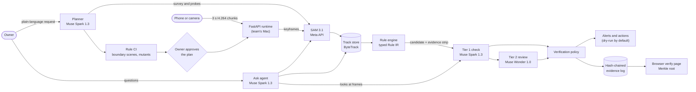

Before 4 Nov the runtime ran on a RunPod CPU pod, sent keyframes to our own SAM 3.1 on
serverless GPUs, and sent the Tier 1 check to Muse Glimmer and Tier 2 to Muse Spark Open, both
on our own GPUs. `/embed` on the SAM GPU gave Ask its identities (DINOv2 for objects, OSNet-AIN
for people, prototype mode only). The RunPod setup is kept as a record in
[`docs/deploy.md`](docs/deploy.md).

### Model map

Which model does which job, where it runs, and how far it is wired today. **Live** means the
deployed app calls it; since 4 Nov 2026 that is the API on the team's Mac, using only the Meta
API. **Before 4 Nov** means it ran in the recorded runs of 1–4 Nov and does not run now.
**Library** means the code is built and tested, but the live app does not call it yet.
**Planned** means it is not built.

| Meta model | Job | Runs where | Status |
|---|---|---|---|
| Muse Spark 1.3 (+1.2 for narrated video) | Planner, compiler, standards grounding, the planner's guardrail pass, Ask agent, retail checks, crowd warden; since 4 Nov the Tier 1 verifier too | Meta API | Live in the Planner (P2-01, P2-06) and in `POST /ask`, where Spark 1.2 can also watch a joined clip of the window it picks (`watch`, add-on 2.8). Since 4 Nov it is also the Tier 1 verifier: the Glimmer client points at the Meta API with `GLIMMER_MODEL=muse-spark-1.3` ([`docs/deploy.md`](docs/deploy.md)). If the Tier 1 call fails, unverified candidates go to the human queue. Crowd watch (`crowd/warden.py`) ran live on the API pod on 3 Nov. Site tools (run live from a laptop on 3 Nov, not yet on the deployed stack): `/context` uses its **web search** with the raw results returned, and keeps an item only if its source is a page the search returned; `/crowd` has it **watch the clip** of each crowded spell; `/shelf` uses its **image understanding** to find shelf gaps |
| Muse Wonder 1.0 | Tier 2 verifier, plan audit, Ask answer review, dispute review | Meta API | Live since 4 Nov: the Spark Open client points at the Meta API with `SPARK_OPEN_MODEL=muse-wonder-1.0`. Failing, Tier 2, plan audit and Ask review are skipped and logged; Tier 1 decides alone and anything unsure goes to a person. Muse Spark 1.3 reviews disputes when no Tier 2 answers |
| Muse Voice Transcribe | Spoken requests, questions, disputes and near-miss reports; hears every spoken warning back | Meta API | Live (warehouse, crowd, supermarket and glasses runs of 4 Nov) |
| SAM 3.1 | Survey, probes, tracking, coverage, masks, head counts | Meta API (hosted). Before 4 Nov also self-hosted on a RunPod serverless GPU (RTX 4090) | Live: hosted client (P1-02) for survey, probes, Rule CI and, since 4 Nov, the runtime's keyframes. Before 4 Nov the runtime sent keyframes to our self-hosted SAM 3.1 (`SAM_BASE_URL`, a RunPod serverless load balancer since 2 Nov) and fell back to hosted (P1-03); crop-zoom (add-on 3.3) re-ran it there on enlarged head and hand crops for worn items. Crowd watch counts heads per zone with it |
| Muse Code | Writes new rule-type checks (`extensions/`), proved with Z3 (add-on 7) | The local `muse` CLI (Meta API) | Live as the local `muse` CLI. The 4 Nov run used the CLI from a laptop: Z3 4/4, mutation 25/26, approved on the live API, run on a real clip. Where no CLI is installed, `POST /extensions` uses Spark 1.3 as the writer, labelled `spark-fallback` |
| Muse Image | Generated test images when no footage exists (spill, restocked shelf, blocked exit), toolbox-talk drawings, Z3 counterexample drawings; Rule CI scenes | Meta API | Live for test images, every one labelled SAMPLE. The Rule CI scenes step (P2-09, #71) is built but skipped |
| MMS-TTS (FAIR) | Spoken warnings and announcements | CPU | Live: Spanish forklift warnings, Hindi and English crowd announcements and glasses answers on 4 Nov, each heard back by Voice Transcribe where the report says so |
| Muse Glimmer 30B (open weights) | Tier 1 verifier, back-translation, recompute, Ask's eyes, crowd check, three-way counts, glasses mode | Before 4 Nov: llama-server on RunPod serverless GPUs in three US data centers, a standby endpoint in two EU data centers, and a hosted fallback (Routeway) as the last resort | Before 4 Nov: live as Tier 1 (P3-03). By default it saw 6 face-blurred keyframes at 640 px (P4-05); the deployed **prototype mode** sent 8 raw frames at 960 px. Not running now; its client calls Muse Spark 1.3 |
| Muse Spark Open 816B-A42B (open weights) | Tier 2 verifier, plan audit, Ask answer review, dispute review | Before 4 Nov: llama.cpp on our own RunPod serverless 8 x H100 endpoint (Baseten stayed an option) | Before 4 Nov: live, $43.12 an hour warm and about 18 minutes to start, so it was warmed for demos. Not running now; its client calls Muse Wonder 1.0 |
| Llama Prompt Guard 2 (86M) | Scene-text firewall | CPU, inside the API process | Not loaded now, so `/runtime/metrics` shows `firewall: degraded` and candidates with scene text go to a person. Before 4 Nov it ran on the API pod |
| Llama Guard 4 12B (FP8) | Screens each request before planning; refuses rules about who people are (S7 privacy, S10 hate) | Before 4 Nov: vLLM on our own RunPod serverless GPU | Not running now. The screen is skipped and the planner's own guardrails still decline banned requests: a fixed pattern check, then Muse Spark |
| DINOv2 (FAIR) | Joins an object's track fragments into one identity for Ask | Before 4 Nov: `/embed` on the SAM serverless GPU | Before 4 Nov: live in prototype mode only (`ask/identity.py`). Not running now |
| Sapiens (FAIR) | Pose and skeletons | GPU | Planned. Meanwhile RTMPose-l body7 (OpenMMLab, ONNX on the API's CPU, when `RULECAM_POSE_ONNX` is set) draws each person's pose into the evidence strips (add-on 3.4) |
| V-JEPA 2 (FAIR) | Surprise Lens world model | GPU | Planned (gated) |

Other models in the pipeline, picked on quality and speed. Before 4 Nov, **OSNet-AIN** person
re-ID vectors (BoxMOT, on the SAM GPU) fed **BoT-SORT**, which tracks people between SAM
keyframes, and Ask's person identities (prototype mode only, body crops, never faces); in the
hackathon deployment people stayed on ByteTrack (`RULECAM_PERSON_TRACKER=bytetrack`) because of
an OSNet fix the GPU volume did not yet carry. **MoGe-2** (Microsoft, on the SAM GPU) gave the
planner a metric ground calibration from one frame (add-on 3.5). Neither runs now: with no GPU
of our own, people and objects are tracked with ByteTrack, and the floor is calibrated from
reference objects ([`docs/deploy.md`](docs/deploy.md)).

### Documents

| File | Purpose |
|---|---|
| [`SUBMISSION.md`](SUBMISSION.md) | The hackathon submission text |
| [`docs/video/script.md`](docs/video/script.md) | The 3-minute video: shot list, voiceover, captions, fallbacks |
| [`docs/pitch/deck.md`](docs/pitch/deck.md) | The 10-slide finals deck with speaker notes |
| [`docs/pitch/launch.md`](docs/pitch/launch.md) | Launch posts and the 30-second vertical cut |
| [`docs/DEMO.md`](docs/DEMO.md) | The live demo script and the golden REPLAY |
| [`docs/demo-day.md`](docs/demo-day.md) | Demo-day runbook: what runs where, start-up checks, failures and fallbacks |
| [`docs/usecases/`](docs/usecases/) | Each world and platform piece in detail |
| [`docs/TASKS.md`](docs/TASKS.md) | Full team task book: rules, contracts, gates, every task |
| [`docs/master-plan.md`](docs/master-plan.md) | Product plan (v3): proof stack, use cases, evaluation |
| [`docs/v2-design.md`](docs/v2-design.md) | Engine internals: Rule IR, perception, Rule CI, verifier, privacy |
| [`docs/site-advisor.md`](docs/site-advisor.md) | Site Advisor: business advice you can check |
| [`src/rulecam/chain/README.md`](src/rulecam/chain/README.md) | Chain Mode: one rule pack for many stores |
| [`docs/deploy.md`](docs/deploy.md) | Deployment: Meta API only since 4 Nov; the earlier RunPod setup (API pod, Glimmer, SAM) kept as the record |
| [`WHAT-WE-BUILT.md`](WHAT-WE-BUILT.md) | What we wrote during the hackathon vs. what we reused, with licences |
| [`evidence/`](evidence/README.md) | Screenshots and verify-page captures behind our claims |
| [`eval/RESULTS.md`](eval/RESULTS.md) | Measured evaluation results |

### Prerequisites

| Tool | Version | Why | Install |
|---|---|---|---|
| [`uv`](https://docs.astral.sh/uv/) | recent | Installs Python 3.12 and the locked dependencies (`uv.lock`) | `curl -LsSf https://astral.sh/uv/install.sh \| sh` or `brew install uv` |
| Python | 3.12 (from `.python-version`) | The API, the CLI and the tests | `uv` installs it for you |
| Node.js + npm | 20 or newer to run the site; 22 for the UI's unit tests (Vitest 4 needs 20.19+ or 22.12+; CI uses 22) | The Next.js web UI | [nodejs.org](https://nodejs.org) or `brew install node` |
| `ffmpeg` | any recent build | Cuts camera video into 3 s H.264 chunks | `brew install ffmpeg` or `sudo apt install ffmpeg` |
| `git` | any | Clone the repo | |
| Docker (optional) | with Compose v2 | `docker compose up --build` instead of local installs | [docs.docker.com](https://docs.docker.com/get-docker/) |
| Meta API key (optional) | Standard tier | Live mode only; replay mode and the golden replay need no key | See `.env.example` |

### Run it on your own machine

You need the tools in [Prerequisites](#prerequisites). On macOS: `brew install uv node ffmpeg`.

```bash
git clone https://github.com/jeevithg090/Axi0N_Meta.git
cd Axi0N_Meta
./start_rulecam.sh
```

On Windows, run `./start_rulecam.ps1` in PowerShell instead. The script checks for the tools
above, creates `.env` from `.env.example`, runs `uv sync` and `npm ci` the first time, loads
made-up SAMPLE data, starts the API on `http://localhost:8000` and the site on
`http://localhost:3000`, and lists the pages to open. Press Ctrl+C to stop both. Logs go to
`data/logs/local-{seed,api,ui}.log`. Use `./start_rulecam.sh --no-seed` to skip the sample data.

- `http://localhost:3000/demo?demo=1` replays a recorded live run. It needs no API keys and
  makes no model calls.
- `/monitor`, `/streams`, `/planner` and `/audit` show the SAMPLE data. Those records were
  written by hand (each one is labelled `[SAMPLE ...]`), so don't quote numbers from them.
- To run with real models, put a Meta API key in `.env.live` (see "Live" below).

Or with Docker: `docker compose up --build` starts the same two services (without the sample
data).

### Quick start (development)

```bash
make setup        # uv sync + pre-commit hooks
cp .env.example .env
make check        # lint + types + tests + coverage floors — must pass before every push
uv run rulecam version
```

Requires Python 3.12 (via `uv`), `ffmpeg`, and Node 20+ for the UI.

```bash
cd ui && npm ci && npm run dev          # the web UI on http://localhost:3000
uv run rulecam chain demo chains/kitchen-basics   # Chain Mode, no models, about 10 s
```

- **Without keys:** open `http://localhost:3000/demo?demo=1`. It replays a recorded live run
  (labelled REPLAY in the header) with no model calls. Nothing in it is hand-written.
- **Live:** put the Meta API key and the "Meta API only" settings from `.env.example` in
  `.env.live` (not `.env`: the tests read `.env`), then follow the "Meta API only" section of
  [`docs/deploy.md`](docs/deploy.md). The header badge reads LIVE.
- **Check an evidence log:** `uv run rulecam audit <YYYY-MM-DD> <site>` re-verifies a day's
  chain and re-derives every decision; or drop the chain file on the browser verify page.

### Usage examples

#### The web UI, step by step

1. Open `http://localhost:3000`. The landing page shows one recorded verified alert and the
   system status from the API. **Open the demo** goes to the golden replay.
2. `/demo?demo=1` walks one request through **Describe → Plan → Prove → Trust**. Everything on it
   is a recording, so it works with the API stopped.
3. **Use cases** in the sidebar (Supermarket, Warehouse, Crowd) tell each world's story from what
   Rulecam recorded. A switch on each page moves between the recorded run and this site's live
   data, when there is any.
4. **Build → Planner**: type a rule in plain words (or pick a preset) and press **Plan this rule
   (live planner)**. In live mode the planner surveys the camera, writes the rule, runs Rule CI
   and asks you to approve; the result appears under **Plans**.
5. **Trust → Verify evidence** opens the static verify page, which re-hashes an evidence chain in
   your browser and compares it with the day's Merkle root.
6. **Run → Staff app** and **Glasses mode** are phone pages; open them on a phone, or in your
   browser's device toolbar.

Keyboard: the first Tab stop on every page is **Skip to content**; **Ctrl+B** (or **Cmd+B**)
collapses the sidebar; **Escape** closes the phone navigation drawer.

#### The API

The API listens on `http://localhost:8000`; FastAPI serves interactive docs at
`http://localhost:8000/docs`. These responses were captured from a fresh local API in replay mode:

```console
$ curl -s localhost:8000/health
{"ok":true,"site":"demo","mode":"replay","runtime":false,"revision":null,
 "gpus":{"glimmer":{"state":"unhealthy","up":false,"serverless":false,"workers_min":null,
 "workers_max":null,"workers":null,"error":"health check failed"}},
 "models":{"tier1":"muse-glimmer-30b","tier1_host":"self-hosted","tier2":null,
 "tier2_host":null,"sam":"sam-3.1","sam_host":"meta-api"}}

$ curl -s localhost:8000/mode
{"mode":"replay","badge":"REPLAY"}

$ curl -s localhost:8000/auth/me          # from the same machine: loopback counts as the owner
{"owner":true,"via":"loopback","csrf_token":null,"expires_at":null,"login_enabled":false}
```

Bad input gets a 422 with every problem listed (here a worker dispute with an empty body):

```console
$ curl -s -X POST localhost:8000/worker/dispute -H 'content-type: application/json' -d '{}'
{"detail":[{"type":"missing","loc":["body","event_code"],"msg":"Field required","input":{}},
 {"type":"missing","loc":["body","reason_choice"],"msg":"Field required","input":{}}]}
```

From another machine, owner routes need a session. Set a passphrase once, put the printed line in
the API's `.env` with a `SESSION_SECRET`, then log in:

```bash
uv run rulecam owner set-passphrase       # prints OWNER_PASSPHRASE_HASH=...
curl -s -c cookies.txt -X POST https://<api-host>/auth/login \
  -H 'content-type: application/json' -d '{"passphrase": "<your passphrase>"}'
```

The web UI does this for you on `/login`. Writes made with the session also need the CSRF token
that `GET /auth/me` returns.

#### The CLI

```bash
uv run rulecam --help                          # every command
uv run rulecam version                         # package and contracts versions
uv run rulecam chain demo chains/kitchen-basics   # Chain Mode on a sample pack, no models (~10 s)
uv run rulecam golden verify warehouse_driver  # replay a golden run from its recording: "5/5 steps reproduced"
uv run rulecam audit <YYYY-MM-DD> <site>       # re-verify a day's chain in data/evidence/ and re-derive each decision
uv run rulecam capture --help                  # turn a camera, stream or file into 3 s chunks
```

`rulecam chain demo` prints each store's readiness, a scorecard marked **SIMULATED**, and what
to fix first, for example:

```text
   store-22 Airport (east): 1/3 ready
     handwash-before-line         ready       Runs on kitchen-cam; Rule CI boundary 13/13, mutations 5/5 on this store.
     fire-exit-clear              needs_setup Needs setup: camera 'back-cam' needs a ground calibration to measure metres for 'egress'
     delivery-to-cold-storage     blocked     Blocked: zone 'staff_break_room' names a private space and can never be watched
```

### Commands

| Command | What it does |
|---|---|
| `./start_rulecam.sh` / `./start_rulecam.ps1` | One-command local run: checks tools, installs, seeds SAMPLE data, starts API (8000) and UI (3000). `--no-seed` skips the sample data |
| `make setup` | `uv sync --group dev`, pre-commit hooks, and `npm ci` for the UI |
| `make fmt` | Ruff format and auto-fix |
| `make lint` | `ruff check` and `ruff format --check` |
| `make type` | mypy over `src` and `tests` |
| `make test` | pytest with coverage, then the per-package coverage floors (`scripts/coverage_floors.py`) |
| `make ui-check` | ESLint, Prettier check, `tsc`, Vitest, and the verify page's cross-language tests |
| `make check` | `lint` + `type` + `test` + `ui-check`: must pass before every push |
| `make api` | The API with auto-reload (`uvicorn rulecam.api.app:app --reload`) |
| `make ui` | The UI dev server (`npm run dev`) |
| `make openapi` | Export the API's OpenAPI schema to the UI and regenerate its TypeScript types |
| `make preflight` | Check the replay cache before a demo |
| `make eval-replay` | Validate the eval set and re-score the recorded baseline offline |
| `make golden-verify` / `make golden-gate` | Replay every golden run in `scenarios/` / re-score them and fail on a broken gate |
| `make golden SCENARIO=<name>` | Record a golden run with real model calls (needs keys) |
| `make live-test` | Tests marked `live` (real model calls; needs keys) |
| `make verify-page-sync` | Copy the evidence verify page into `ui/public/verify/` |
| `make eval-caviar` | Play the CAVIAR clips into a running API and score them (run on the API host) |
| `make ship-api` / `make ship-gpu` | The earlier RunPod deploys, kept as a record (not running) |

Inside `ui/`:

| npm script | What it does |
|---|---|
| `npm run dev` | Next.js dev server on port 3000 |
| `npm run build` / `npm run start` | Production build / serve it |
| `npm run lint` | ESLint, zero warnings allowed |
| `npm run typecheck` | `tsc --noEmit` (strict) |
| `npm test` | Vitest (watch mode; `npm test -- --run` runs once) |
| `npm run test:verify-page` | Tests of the browser verify page in `src/rulecam/evidence/verify_page` |
| `npm run format` / `npm run format:check` | Prettier write / check |
| `npm run openapi` | Regenerate `src/api/schema.d.ts` from `src/api/openapi.json` |

### Tech stack

| Layer | What we use |
|---|---|
| Backend | Python 3.12, FastAPI + Uvicorn, Pydantic v2 (typed contracts in `src/rulecam/contracts`), Typer CLI (`rulecam`), structlog |
| Video and perception | ffmpeg (3 s H.264 chunks), OpenCV (headless), SAM 3.1 (hosted by Meta), ByteTrack via `trackers` + `supervision`, Shapely for zones |
| Models | Meta API (Muse Spark 1.3, Muse Wonder 1.0, SAM 3.1, Voice Transcribe, Muse Image), all through `rulecam.clients` and a replay cache |
| Storage and proof | DuckDB + Parquet track store, SHA-256 hash-chained evidence log with daily Merkle roots, Z3 for proving model-written checks |
| Web UI | Next.js 15 (App Router), React 19, TypeScript (strict), Vitest + Testing Library |
| Tooling | uv, Ruff (lint + format), mypy, pytest + Hypothesis, ESLint, Prettier, pre-commit, GitHub Actions |

### The web UI

The UI in `ui/` is a Next.js App Router app with three frames: the landing page (`/`), the owner
console (a grouped sidebar: use cases, build, run, trust, system) and bare pages for people
outside the console (the worker QR page, the station tablet, the staff app, glasses mode and the
inspector's proof view).

- **Design system.** One set of tokens in `ui/src/app/globals.css`: a spacing scale
  (`--space-3xs` … `--space-4xl`), a type scale with fluid display sizes, motion durations and
  easings, z-index layers, and two colourways, *paper* (light) and *graphite* (dark), in OKLCH.
  Amber marks a person or the one primary control; cool blue marks an instrument reading; green
  and red are status only. Two self-hosted fonts (Host Grotesk for text, Atkinson Hyperlegible
  Mono for measured values), so a build never touches the network. Shared pieces (badges,
  metric tiles, empty states, skeletons, timelines, step flows) live in `ui/src/components/kit`.
- **Light and dark.** The page follows the system setting until you choose; the choice is stored
  and applied before first paint, so there is no flash.
- **Honesty labels.** LIVE, REPLAY, SAMPLE and OFFLINE come from the API's own badge strings.
  A replay is never shown as live, screens built from hand-written examples say SAMPLE DATA, and
  an unknown value shows "unknown" or "—", never a made-up number.
- **States.** Data screens have loading skeletons, empty states that say what fills them, error
  states with the API's reason, and owner-only notices for visitors. The app has an error
  boundary with **Try again** and a 404 page.
- **Accessibility.** Semantic landmarks and one `h1` per page, a skip link, visible focus rings,
  labelled form fields and icon buttons, `aria-current` in the navigation, `aria-pressed` on
  toggles, screen-reader announcements for errors, reduced motion respected, and an 18 px
  minimum for checkboxes.
- **Responsive.** The sidebar becomes a drawer below 760 px. Pages were checked at 375, 768,
  1024, 1280 and 1440 px for horizontal scroll and for content cut off at the right edge; wide
  tables scroll inside their card.
- **Page metadata.** Every screen has its own title (`Planner · Rulecam`) and description, an SVG
  favicon, an Apple touch icon, and Open Graph / Twitter card tags with a share image captured
  from the landing page (`ui/src/app/opengraph-image.png`).
- **Staff app.** `/staff` installs as a PWA (manifest and service worker in `ui/public/`) and
  stays dark on the floor.

### Configuration

All settings are environment variables, read by `src/rulecam/config.py` (pydantic-settings).
[`.env.example`](.env.example) lists every one with a comment; copy it to `.env` for development
and keep live keys in `.env.live` (both are git-ignored). The ones you are most likely to touch:

| Variable | Default | Purpose |
|---|---|---|
| `RULECAM_MODE` | `replay` | `replay` serves recorded model replies (no network), `record` records new ones, `live` calls the models |
| `RULECAM_DATA_DIR` | `./data` | Chunks, track store, evidence chains and logs |
| `META_API_KEY` | empty | Meta Model API key (Standard tier). Needed only for live mode |
| `META_API_BASE_URL` | empty | Meta API base URL, from the Meta API docs |
| `RULECAM_ACTIONS_DRY_RUN` | `true` | Record actions as "dry-run: would ..." instead of running them |
| `RULECAM_PROTOTYPE_MODE` | `false` | The hackathon's prototype mode (see "What we claim" below) |
| `PUBLIC_DEMO` | `false` | Let non-owners watch `/ws` and read plans on a demo site |
| `NEXT_PUBLIC_RULECAM_API` (UI) | `http://localhost:8000` | The API address the browser uses (WebSocket), baked in at build time |
| `RULECAM_API_URL` (UI) | `NEXT_PUBLIC_RULECAM_API` | Where the Next.js server forwards `/rulecam-api/*`, when it reaches the API on another address (docker compose) |

Optional integrations (WhatsApp, Telegram, signed webhooks, Kasa smart plugs, self-hosted
Glimmer/SAM endpoints, budgets) are all off when their variables are empty.

The web UI reads four variables of its own:

| Variable | Required | Default | Notes |
|---|---|---|---|
| `NEXT_PUBLIC_RULECAM_API` | No | `http://localhost:8000` | The API address the browser uses; baked in at build time |
| `RULECAM_API_URL` | No | `NEXT_PUBLIC_RULECAM_API` | Where the Next.js server forwards `/rulecam-api/*` when it reaches the API on another address (docker compose: `http://rulecam-api:8000`) |
| `RULECAM_PROXY_SECRET` | No | unset | Server-only. Equal to the API's `UI_PROXY_SECRET`; lets the API trust the browser's address for per-client rate limits behind a proxy |
| `NEXT_PUBLIC_SITE_URL` | No | `https://rulecam-live.vercel.app` | Absolute base for Open Graph and share links |

<details>
<summary>Every API setting (152, generated from <code>src/rulecam/config.py</code>)</summary>

Names are case-insensitive. Notes come from the comments in `config.py` and `.env.example`; a
note at the top of a group applies to the settings under it. "Secret" values are never logged.
Nothing is required in replay mode; live mode needs `META_API_KEY` and `META_API_BASE_URL`, plus
the "Meta API only" block of `.env.example`.

| Variable | Required | Default | Notes |
|---|---|---|---|
| `RULECAM_MODE` | No | `replay` | live \| record \| replay |
| `RULECAM_DATA_DIR` | No | `./data` | Chunks, track store, evidence chains, replay cache and logs |
| `RULECAM_REPLAY_DIR` | No | `unset` | optional override of the replay cache directory |
| `RULECAM_SITE_CONFIG` | No | `unset` | owner's site YAML (docs/site.example.yaml) |
| `RULECAM_RUNTIME` | No | `False` | start the runtime loop (SAM, tracker, Glimmer) with the API |
| `RULECAM_REVISION` | No | `unset` | The git SHA served in GET /health; unset, the REVISION file `make ship-api` writes is read. |
| `RULECAM_IDLE_STRIDE_LOW` | No | `3` | Runtime SAM cost control (docs/deploy.md "Runtime SAM cost"): while nothing is happening on a camera, segment one chunk in N, per the strictest severity of the rules on that camera. |
| `RULECAM_IDLE_STRIDE_MEDIUM` | No | `3` | Idle stride for cameras whose strictest rule is MEDIUM (see `RULECAM_IDLE_STRIDE_LOW`) |
| `RULECAM_IDLE_STRIDE_HIGH` | No | `2` | HIGH: every 2nd chunk at most |
| `RULECAM_IDLE_HOLDOFF_S` | No | `30.0` | every chunk for 30 s after activity |
| `RULECAM_BUDGET_USD_PER_CAMERA_HOUR` | No | `12.0` | Per-camera dollar budget (runtime.cost): hosted SAM spend over the last minute as $/h, plus the camera's share of the GPU pods. At or above it: alarm, and with hosted spend, degrade to one chunk in RULECAM_SAM_BUDGET_STRIDE. 12 $/h = the former 1,000 hosted frames/min. 0 = no budget |
| `RULECAM_GPU_USD_PER_HOUR` | No | `0.0` | GPU pods' combined $/h |
| `RULECAM_GPU_WORKER_USD_PER_HOUR` | No | `1.34` | One running RunPod serverless worker's $/h (RTX 4090 pool); with serverless GPUs whose worker state is known, only running workers are charged (runtime.serverless). |
| `RULECAM_SAM_BUDGET_FRAMES_PER_MIN` | No | `0` | optional frame cap; 0 = off |
| `RULECAM_SAM_BUDGET_STRIDE` | No | `3` | over budget: one chunk in N |
| `RULECAM_IDLE_STOP_GPU_AFTER_S` | No | `0.0` | Stop the GPU pods after this many seconds with no camera on an active plan (runtime.idle_stop); 0 = never. Needs the RunPod key in RULECAM_RUNPOD_API_KEY_FILE. |
| `RULECAM_IDLE_STOP_GPU_PODS` | No | `rulecam-glimmer,rulecam-sam` | pod names or ids |
| `RULECAM_RUNPOD_API_KEY_FILE` | No | `unset` | mode 600; read per call, never logged; also reads serverless GPU state (else SAM_EDGE_KEY / GLIMMER_EDGE_KEY) |
| `RULECAM_RUNTIME_CONCEPT_WORKERS` | No | `4` | concepts segmented at once |
| `RULECAM_RUNTIME_PIPELINE_DEPTH` | No | `4` | chunks per camera in flight |
| `RULECAM_SAM_MAX_CONCURRENCY` | No | `8` | Runtime SAM calls open at once, across cameras (docs/deploy.md "Stage timings"). |
| `RULECAM_RUNTIME_VERIFY_WORKERS` | No | `4` | Tier 1 verifications at once |
| `RULECAM_VERIFY_RETRIES` | No | `1` | Tier 1 retry and circuit breaker (verify.guard): retries after a transient failure, the failures in a row that open the circuit, and how long it stays open before a trial. |
| `RULECAM_VERIFY_BREAKER_FAILURES` | No | `3` | failures in a row that open the Tier 1 circuit (fail fast to the human queue) |
| `RULECAM_VERIFY_BREAKER_COOLDOWN_S` | No | `30.0` | how long the circuit stays open before a trial (doubles, up to 5 min) |
| `RULECAM_RUNTIME_SAM_MASKS` | No | `False` | Decode hosted SAM masks on the runtime path (pure-Python, GIL-bound; boxes suffice for feet). |
| `RULECAM_RUNTIME_SAM_MODE` | No | `image` | Runtime perception (docs/deploy.md "Runtime perception modes"): `image` runs SAM 3.1 image mode on keyframes and joins them with ByteTrack; `video` sends whole chunks to SAM 3.1 video. |
| `RULECAM_KEYFRAME_FPS` | No | `2.0` | keyframes per second |
| `RULECAM_KEYFRAME_FPS_CAMERAS` | No | `empty` | per-camera overrides, e.g. "dock=4,kitchen=3" |
| `RULECAM_TRACKER_LOW_CONFIDENCE` | No | `0.1` | Image mode: the lowest SAM score the keyframe tracker gets (ByteTrack's second pass, which only extends existing tracks); everything else keeps SAM's 0.5 cut. |
| `RULECAM_PERSON_TRACKER` | No | `botsort` | Image mode: the tracker for people. `botsort` (BoT-SORT with OSNet-AIN person re-ID vectors from the SAM pod, `perception.botsort`) runs only in prototype mode with the `reid` extra installed; otherwise, and for every other concept, ByteTrack. |
| `RULECAM_OPERATOR_EXCLUSION_OFF` | No | `empty` | Rule ids whose owner turned operator exclusion off (comma-separated; rules/operators.py): for these, a person riding a forklift counts as a pedestrian next to it. |
| `RULECAM_OPERATOR_WARMUP_S` | No | `1.5` | How long a person first seen on board a vehicle is held as its operator pending before being judged operator or pedestrian (rules/operators.py rule 7); 0 turns the hold off. |
| `RULECAM_FACE_MODEL` | No | `unset` | YuNet face-detector ONNX (opencv_zoo) for blurring faces in evidence strips; without it only the head regions of tracked people are blurred (runtime.strips). |
| `RULECAM_ACTIONS_DRY_RUN` | No | `True` | Record actions as `dry-run: would …` and execute none of them (no power cut, light, speaker or notification) until the owner turns this off (docs/deploy.md "Actions"). |
| `RULECAM_REGRESSIONS_DIR` | No | `unset` | Where confirmed false alarms become permanent Rule CI lookalike regressions (P2-09, `rule_ci.hard_negatives`); default `<data dir>/rule_ci/regressions`. |
| `RULECAM_PROTOTYPE_MODE` | No | `False` | Prototype mode (`rulecam.prototype`): the planner declines nothing but rules that single people out by race, ethnicity, religion, nationality or sexual orientation; every compiled rule activates (failed checks are caveats); the verifier's verdict is final. |
| `RULECAM_SITE_TIMEZONE` | No | `UTC` | The site's time zone (IANA name), for owner questions like "how many customers at 1 pm". |
| `RULECAM_SITE_CITY` | No | `empty` | The site's approximate location for `/context` (Spark's web search is localised by it). |
| `RULECAM_SITE_REGION` | No | `empty` | Region part of the site location used by `/context` web search |
| `RULECAM_SITE_COUNTRY` | No | `empty` | ISO 3166-1 |
| `RULECAM_CROWD_BUSY_PER_M2` | No | `2.0` | Crowd density levels for `/crowd`, persons per m² (rulecam.crowd.density). |
| `RULECAM_CROWD_CROWDED_PER_M2` | No | `4.0` | people can no longer choose where they walk |
| `RULECAM_CROWD_CRITICAL_PER_M2` | No | `5.0` | pressure can build through the crowd; escalates on density alone |
| `RULECAM_SITE_PROFILE` | No | `empty` | Context for `POST /ask` (the owner's words, given to the models as they are): what the site is, and camera id -> name pairs ("phone-62=checkout lanes,phone-61=entrance queue"). |
| `RULECAM_CAMERA_NAMES` | No | `empty` | Camera id -> name pairs for `POST /ask`, e.g. `phone-62=checkout lanes,phone-61=entrance queue` |
| `RULECAM_ASK_CAPTION_EVERY_S` | No | `0.0` | Ask's temporal memory: Glimmer captions each camera every N seconds of video; 0 = off. |
| `RULECAM_ASK_IDENTITIES` | No | `True` | Ask's identity memory: join track fragments by DINOv2 appearance on the GPU pod's /embed. |
| `RULECAM_ASK_PERSON_REID` | No | `True` | ... and people by OSNet-AIN person re-ID vectors (`/embed` model "person", add-on 3.2) instead of DINOv2; falls back to DINOv2 when the GPU pod has no re-ID model. Prototype mode only. |
| `RULECAM_ASK_MAX_ROWS` | No | `1000` | How much tool output reaches Spark in Ask (anything cut is reported to it, never silent): rows per SQL query, characters of results per turn, instants per count/look call. |
| `RULECAM_ASK_MAX_RESULT_CHARS` | No | `100_000` | characters of tool results per turn, shared by the turn's actions |
| `RULECAM_ASK_MAX_FRAMES` | No | `6` | instants per count_objects / look call |
| `RULECAM_ASK_MAX_ACTIONS` | No | `6` | Tool calls one Ask turn runs at the same time (Spark picks how many, up to this). |
| `RULECAM_ASK_MAX_WATCH_S` | No | `180.0` | Ask's `watch` tool: the longest window joined into one clip for Spark, and the Spark model that takes video (Spark's video limits are not published; the clip is capped to this). |
| `RULECAM_ASK_WATCH_MODEL` | No | `muse-spark-1.2` | the Spark model that takes video |
| `RULECAM_ASK_REVIEW` | No | `True` | Muse Spark Open (Baseten) checks each Ask answer against its trace and can send it back once (needs BASETEN_API_KEY; off without it). |
| `RULECAM_MUSE_CODE_BIN` | No | `muse` | Rule extensions (`rulecam.extensions`): Muse Code writes a new check type headless (`muse exec --json`), authenticated once with `muse auth set --api-key-stdin`. Extra arguments go after `exec --json` (shell-split), e.g. an approval mode for file edits. |
| `RULECAM_MUSE_CODE_ARGS` | No | `empty` | extra args after `exec --json` |
| `RULECAM_MUSE_CODE_TIMEOUT_S` | No | `300.0` | Seconds one Muse Code run may take (up to 1800) |
| `RULECAM_MUSE_CODE_MODEL` | No | `muse-spark-1.2` | the model Muse Code runs on (recorded with each version) |
| `RULECAM_CHAINS_DIR` | No | `chains` | Chain Mode (`rulecam.chain`): one folder per rule pack (pack.yaml, stores/, simulation.yaml) served by the owner-only `/chain` routes. |
| `RULECAM_GIT_SHA` | No | `empty` | The deployed commit, for Ask's run log (empty: `git rev-parse HEAD` when run from a clone). |
| `RULECAM_CROWD_EVERY_S` | No | `0.0` | Crowd early warning (`rulecam.crowd`, prototype mode): measure each camera's crowd every N seconds of video (SAM 3.1 on grid x grid tiles counting the concept); 0 = off. |
| `RULECAM_CROWD_CONCEPT` | No | `person` | What crowd watch counts with SAM 3.1 |
| `RULECAM_CROWD_GRID` | No | `2` | Crowd watch splits each frame into grid x grid tiles (1 to 4) |
| `RULECAM_CROWD_ASSESS_EVERY_S` | No | `10.0` | Seconds between the warden's assessments (Muse Spark) of a watched camera. |
| `RULECAM_CROWD_CHECK_TIMEOUT_S` | No | `20.0` | Seconds Muse Glimmer gets to check an alert's frames; past it the alert goes unchecked. |
| `RULECAM_CROWD_CAMERAS` | No | `empty` | Cameras to measure (comma-separated ids; empty: every camera with video). With an instruction, they are watched from start-up in these announcement languages ("hi,en"). |
| `RULECAM_CROWD_INSTRUCTION` | No | `empty` | The owner's crowd instruction; with it, `RULECAM_CROWD_CAMERAS` are watched from start-up |
| `RULECAM_CROWD_LANGUAGES` | No | `empty` | Announcement languages for crowd watch, e.g. `hi,en` |
| `RULECAM_OWNER_PASSPHRASE` | No | `unset` | Secret. Only for command-line clients that log in to a remote API as the owner (`rulecam eval ask`); the API itself never reads it (it checks OWNER_PASSPHRASE_HASH). |
| `RULECAM_STRIP_FRAMES` | No | `6` | Evidence strips sent to Glimmer: frames per strip and their width in pixels. |
| `RULECAM_STRIP_MAX_WIDTH` | No | `640` | Width in pixels of each evidence-strip frame (320 to 1920) |
| `RULECAM_POSE_ONNX` | No | `unset` | RTMPose-l body7 ONNX (`scripts/fetch_rtmpose.sh`; runs on the CPU, needs `onnxruntime`): strips then draw each person's real pose instead of a figure fitted to the box. Unset, or a file whose sha256 is not RULECAM_POSE_SHA256 (pose.keypoints.RTMPOSE_BODY7_ONNX_SHA256), means no pose. |
| `RULECAM_POSE_SHA256` | No | `cff059fd58a2c0d5fabaddcd66a96abcfb327563bcb0149ea59c9de4a8990fe2` | the default: the pinned body7 ONNX |
| `RULECAM_CROP_ZOOM` | No | `True` | Crop-zoom SAM 3.1 (add-on 3.3): look for small worn items (hats, hair nets, gloves) on enlarged head and hand crops of each person, at probe time and as Tier 0 before Glimmer. Served by the GPU pod's /segment_crops when SAM_BASE_URL is set, else by hosted SAM. |
| `RULECAM_CALIBRATION_MODEL` | No | `auto` | Ground calibration from MoGe-2 on the GPU pod (add-on 3.5): `auto` uses it when the pod's /health says it is installed, `moge` always tries it, `off` keeps only the reference objects and the 1.7 m-person guess. Off in replay mode (its calls were never recorded). |
| `META_API_KEY` | Live mode | `unset` | Secret. |
| `META_API_BASE_URL` | Live mode | `unset` | from dev.meta.ai docs; do not hard-code |
| `BASETEN_API_KEY` | No | `unset` | Secret. |
| `BASETEN_BASE_URL` | No | `https://inference.baseten.co/v1` | Baseten OpenAI-compatible Model APIs |
| `BASETEN_SPARK_OPEN_MODEL` | No | `meta-models/muse-spark-open-1026` | confirm the exact ID in #credit-requests |
| `SPARK_OPEN_IMAGES_SUPPORTED` | No | `False` | Whether the Tier 2 endpoint accepts images (`true` for Muse Wonder on the Meta API) |
| `SPARK_OPEN_BASE_URL` | No | `unset` | Muse Spark Open on any OpenAI-compatible server instead of Baseten (wins when set): our own llama-server on a RunPod serverless load balancer (docs/deploy.md "Serverless Muse Spark Open"; the RunPod key in SPARK_OPEN_EDGE_KEY goes in `Authorization`, SPARK_OPEN_API_KEY in `X-Rulecam-Key`) or a hosted provider (no edge key: SPARK_OPEN_API_KEY is the bearer). |
| `SPARK_OPEN_API_KEY` | No | `unset` | Secret. |
| `SPARK_OPEN_EDGE_KEY` | No | `unset` | Secret. |
| `SPARK_OPEN_MODEL` | No | `muse-spark-open` | Tier 2 model name; `muse-wonder-1.0` in the Meta-API-only setup |
| `SPARK_OPEN_HARDWARE` | No | `runpod-8xH100-llama.cpp-Q4_K_S` | Label recorded with Tier 2 verdicts (where the model ran) |
| `SPARK_OPEN_SCHEMA_IN_PROMPT` | No | `True` | State the JSON schema in a system message too: llama-server's Muse Spark template does not enforce `response_format` (checked 4 Nov 2026). Applies to SPARK_OPEN_BASE_URL only. |
| `SPARK_OPEN_STRICT_SCHEMA` | No | `True` | `strict` in `response_format`; false for the Meta API (see GLIMMER_STRICT_SCHEMA). |
| `SPARK_OPEN_FALLBACK_BASE_URL` | No | `unset` | Hosted Spark Open used only when the server above gives no usable answer (e.g. Routeway, https://api.routeway.ai/v1, model `muse-spark-open`; its key is the bearer). |
| `SPARK_OPEN_FALLBACK_API_KEY` | No | `unset` | Secret. |
| `SPARK_OPEN_FALLBACK_MODEL` | No | `muse-spark-open` | Model name at the hosted Tier 2 fallback |
| `LLAMA_GUARD_BASE_URL` | No | `unset` | Llama Guard 4 (12B) on an OpenAI-compatible server (`clients.open_weights.llama_guard`): the plan-time screen that refuses rules about who people are. Same key scheme as Spark Open. |
| `LLAMA_GUARD_API_KEY` | No | `unset` | Secret. |
| `LLAMA_GUARD_EDGE_KEY` | No | `unset` | Secret. |
| `LLAMA_GUARD_MODEL` | No | `llama-guard-4-12b` | Llama Guard model name (not running since 4 Nov) |
| `GLIMMER_BASE_URL` | No | `http://127.0.0.1:8080/v1` | llama-server OpenAI-compatible endpoint |
| `GLIMMER_API_KEY` | No | `unset` | Secret. |
| `GLIMMER_EDGE_KEY` | No | `unset` | Secret. The Glimmer URLs are RunPod serverless load balancers: their edge takes this RunPod API key as `Authorization`, and GLIMMER_API_KEY goes in `X-Rulecam-Key` (`llama_edge` checks it). |
| `GLIMMER_MODEL` | No | `muse-glimmer-30b` | Tier 1 model name; `muse-spark-1.3` in the Meta-API-only setup |
| `GLIMMER_EXTRA_BASE_URLS` | No | `empty` | More llama-server URLs serving the same model, comma-separated: Tier 1 calls are spread over all of them, least busy first, with failover (`clients.transport.PooledTransport`). |
| `GLIMMER_QUANT` | No | `empty` | Label recorded with Tier 1 verdicts (quantisation) |
| `GLIMMER_HARDWARE` | No | `empty` | Label recorded with Tier 1 verdicts (where the model ran) |
| `GLIMMER_SCHEMA_IN_PROMPT` | No | `False` | Hosted OpenAI-compatible Glimmer (e.g. Routeway) may honour JSON mode but not a strict schema: also state the schema in a system message. Off for llama-server (grammar-enforced). |
| `GLIMMER_STRICT_SCHEMA` | No | `True` | `strict` in `response_format`. A host applying OpenAI strict-mode rules (the Meta API: every property required) rejects our pydantic schemas, which have defaults; false sends `strict: false` and the reply is validated here, as `SparkClient` does. |
| `GLIMMER_STANDBY_BASE_URL` | No | `unset` | A standby Glimmer endpoint (same keys and model, any region; docs/deploy.md "Standby Glimmer") tried when GLIMMER_BASE_URL and the extra URLs give no usable answer. |
| `GLIMMER_FALLBACK_BASE_URL` | No | `unset` | Automatic fallback when our Glimmer GPU gives no usable answer (no HTTP answer, 404, 429, 5xx): the same request, rewritten for a hosted OpenAI-compatible Glimmer (e.g. Routeway, https://api.routeway.ai/v1 with model `muse-glimmer-30b`, or `muse-glimmer-30b:free`). |
| `GLIMMER_FALLBACK_API_KEY` | No | `unset` | Secret. |
| `GLIMMER_FALLBACK_MODEL` | No | `muse-glimmer-30b` | Model name at the hosted Tier 1 fallback |
| `GLIMMER_MAX_TOKENS` | No | `1024` | Glimmer's output cap per call, reasoning included. A reply cut at it (finish_reason `length`) is retried with the cap doubled, up to the ceiling, then reported. |
| `GLIMMER_MAX_TOKENS_CEILING` | No | `4096` | a reply cut at the cap (finish_reason=length) is retried with it doubled, up to this |
| `GLIMMER_REASONING_BUDGET_TOKENS` | No | `-1` | llama.cpp's per-request `reasoning_budget_tokens` (thinking tokens before the model must answer). -1: not sent, the server's --reasoning-budget applies (unlimited by default); 0: no thinking. Off by default so recorded Tier 1 replies keep their replay keys; pick a value with scripts/eval/glimmer_budget_sweep.py. |
| `EVIDENCE_DIR` | No | `./evidence` | Directory of evidence captures |
| `HF_TOKEN` | No | `unset` | Secret. |
| `MODAL_TOKEN_ID` | No | `unset` | Secret. |
| `MODAL_TOKEN_SECRET` | No | `unset` | Secret. |
| `SAM_BASE_URL` | No | `unset` | our own GPU pod running sam_server; wins over Modal |
| `SAM_API_KEY` | No | `unset` | Secret. |
| `SAM_EDGE_KEY` | No | `unset` | Secret. SAM_BASE_URL is a RunPod serverless load balancer: its edge takes this RunPod API key as `Authorization`, and SAM_API_KEY goes in `X-Rulecam-Key` to the worker. |
| `SAM_HTTP_TIMEOUT_S` | No | `60.0` | Seconds one self-hosted SAM call may take (a RunPod cold start included) and how many tries it gets before the runtime falls back to hosted SAM for that call. 60 s x 2 waits up to 2 minutes on a throttled endpoint; for live demos 25 s x 1 (docs/demo-day.md). |
| `SAM_HTTP_ATTEMPTS` | No | `2` | Tries per self-hosted SAM call before falling back to hosted SAM (1 to 4) |
| `KASA_PLUG_HOST` | No | `unset` | smart plug for the toy-forklift interlock |
| `KASA_LIGHT_HOST` | No | `unset` | stack light / RGB bulb |
| `WHATSAPP_TOKEN` | No | `unset` | Secret. |
| `WHATSAPP_PHONE_NUMBER_ID` | No | `unset` | WhatsApp Business phone number id |
| `WHATSAPP_APP_SECRET` | No | `unset` | Secret. verifies X-Hub-Signature-256 on the webhook |
| `WHATSAPP_VERIFY_TOKEN` | No | `unset` | Secret. the webhook subscription handshake |
| `WHATSAPP_RECIPIENTS` | No | `unset` | Secret. role=E.164 pairs, e.g. "aide=15551234567,charge_nurse=15557654321" (kept only in .env) |
| `WHATSAPP_API_BASE` | No | `https://graph.facebook.com/v21.0` | WhatsApp Graph API base URL |
| `TELEGRAM_BOT_TOKEN` | No | `unset` | Secret. Telegram alerts (add-on 5.1): the token from BotFather; links come from `/telegram/link`. |
| `TELEGRAM_BOT_USERNAME` | No | `unset` | without @; asked from getMe when unset |
| `TELEGRAM_API_BASE` | No | `https://api.telegram.org` | Telegram Bot API base URL |
| `RULECAM_WEBHOOKS` | No | `unset` | Secret. Signed outbound webhooks (add-on 5.4): `preset=url` pairs (generic, slack, teams), kept only in `.env` because the URLs are secrets, and the HMAC secret that signs every request. |
| `RULECAM_WEBHOOK_SECRET` | No | `unset` | Secret. |
| `PUBLIC_TUNNEL_URL` | No | `unset` | https tunnel for Pair-a-Phone and webhooks |
| `PUBLIC_UI_URL` | No | `unset` | public origin of the web UI (worker page QR on posters) |
| `RULECAM_UI_EXTRA_ORIGINS` | No | `empty` | More web UI hosts owner sessions may act from, comma-separated (e.g. a fallback UI host). |
| `OWNER_PASSPHRASE_HASH` | No | `unset` | Secret. Owner login (docs/deploy.md "Owner login"): `rulecam owner set-passphrase` prints the hash. |
| `SESSION_SECRET` | No | `unset` | Secret. signs owner session cookies; 32+ characters |
| `SESSION_TTL_S` | No | `43200` | Owner session lifetime in seconds (300 to 7 days) |
| `UI_PROXY_SECRET` | No | `unset` | Secret. Shared with the UI's middleware, which then forwards the browser's IP (per-client limits). |
| `PUBLIC_DEMO` | No | `False` | Demo sites only: let non-owners watch the live feed and read plans. Never on a real site, where those reads stay owner-only (W-01). |
| `PLANNER_SURVEY_WINDOW_S` | No | `60.0` | seconds of recent chunks the planner samples frames from |
| `RULECAM_DISPUTE_SPARK_FALLBACK` | No | `True` | Without Tier 2 (Spark Open), Muse Spark 1.3 reviews worker disputes with the evidence frames instead of leaving every one pending for a person (`worker.spark_review`). |
| `RULECAM_COVERAGE_LOG` | No | `False` | Chain a `coverage` record when a camera goes BLIND or recovers (`runtime.coverage_log`). Off by default: moving-camera stock clips flap `moved`; turn it on for fixed site cameras. |
| `PLANNER_SURVEY_REUSE_S` | No | `1800.0` | Reuse a camera's survey (inventory, calibration) for this long when its scene is unchanged (`planner.survey_cache`); 0 surveys every time. The probe and Rule CI always run. |
| `RULECAM_SHARE_SECRET` | No | `unset` | Secret. Proof portal (`compliance/`): signs share links; default a random key in <data>/compliance. |
| `RULECAM_CONNECTORS_FPS` | No | `10.0` | Camera connectors (`rulecam.connectors`, `/connectors`): chunk rate, the widest frame kept (wider streams are scaled down) and how many 3 s chunk files each camera keeps. |
| `RULECAM_CONNECTORS_MAX_WIDTH` | No | `1280` | Widest frame kept from a connected camera; wider streams are scaled down |
| `RULECAM_CONNECTORS_KEEP_CHUNKS` | No | `1200` | How many 3 s chunk files each camera keeps |
| `RULECAM_WEARABLES_GLIMMER_TIMEOUT_S` | No | `25.0` | Smart glasses (`/wearables`): how long a look waits for Glimmer before Muse Spark looks. |

</details>

### API reference

The API is FastAPI (`src/rulecam/api/`). With it running, `http://localhost:8000/docs` is the
interactive reference and `uv run rulecam openapi <file>` exports the schema. There are 169
routes (168 HTTP routes plus the `/ws` WebSocket).

**Auth.** *Owner* routes accept a request from the API's own machine (loopback) or an owner
session cookie from `POST /auth/login`; writes made with a session also check the Origin and a
CSRF token. *None* means no owner session is needed: health and metrics, the evidence roots and
hashes anyone can verify, advice reads, the worker QR page and disputes, and the public voice
near-miss report. Phone pairing uses a one-time token over HTTPS, and a shared proof pack uses a
signed share token.

| Area | Routes | Auth | What it covers |
|---|---|---|---|
| `/health`, `/mode`, `/metrics`, `/runtime/metrics`, `/cameras` | 8 | None (setting the mode and the runtime plan: Owner) | Health and models in use, replay/record/live mode, Prometheus metrics, runtime counters |
| `/auth` | 3 | None / session | Owner login, logout and "who is asking" |
| `/plans` | 9 | Owner | Plain-language plan requests, uploads, the planner's questions, approval |
| `/alerts`, `/incidents`, `/ack`, `/correction`, `/interlock` | 8 | Owner | The alert queue, incidents and their reports, acknowledgements, corrections, resuming an interlock |
| `/evidence` | 5 | None (the full chain: Owner) | Days with evidence, hashes, Merkle roots and server-side verification |
| `/ask` | 3 | Owner | Ask a question over recorded tracks and video, streamed step by step |
| `/advice` | 4 | None (accepting: Owner) | Site Advisor cards and their sealed causes |
| `/worker` | 4 | None | The worker QR page, its poster, and disputes (typed or by voice) |
| `/staff` | 18 | Owner | The staff app: per-role feed (also streamed), actions, media, spoken alerts, Ask, shelf photos, web push |
| `/connectors` | 14 | Owner | Add, restart and remove cameras (RTSP, HLS, MJPEG, ONVIF, uploads), snapshots, surveys |
| `/pair` | 5 | Pairing token | Pair a phone as a camera by QR code and receive its clips |
| `/retail` | 23 | Owner | Supermarket overview, checks (also on a staff photo), standing watches, staff tasks closed with proof, advice, briefs, scorecard, Ask receipts |
| `/warehouse` | 20 | Owner (voice near-miss report: None) | Warehouse story, near misses, heatmaps, spoken warnings, toolbox talks, follow-up duties, shift reports, voice reports |
| `/crowd` | 14 | Owner | Crowd watch set-up, venue layout, live status (also as Server-Sent Events), alerts |
| `/shelf`, `/context` | 5 | Owner | Shelf-gap scans and search-grounded site context |
| `/wearables` | 8 | Owner | Glasses mode: look, walks, frames and spoken answers |
| `/proof` | 8 | Owner (shared views: share token) | Proof packs for inspectors: create, share, revoke |
| `/chain` | 4 | Owner | Chain Mode packs, proofs and store fit |
| `/extensions` | 5 | Owner | Muse Code rule extensions: propose, list, approve, retire |

<details>
<summary>Every route (generated from the running app's route table)</summary>

Descriptions are the first line of each handler's docstring; where a handler has none, its
function name is shown.

| Method | Path | Auth | What it does |
|---|---|---|---|
| WS | `/ws` | Owner (or anyone on a `PUBLIC_DEMO` site from an allowed origin) | Live event stream: the bus mirrored to the browser |
| POST | `/auth/login` | None | Check the passphrase and set the session cookie. |
| POST | `/auth/logout` | Session + CSRF | Revoke the session (a write: Origin and CSRF are checked) and clear the cookie. |
| GET | `/auth/me` | None | Who is asking (never cached). |
| GET | `/health` | None | Health |
| GET | `/mode` | None | Get mode |
| PUT | `/mode` | Owner | Set mode |
| GET | `/metrics/perception` | None | Perception metrics |
| GET | `/metrics` | None | Metrics |
| GET | `/cameras` | None | Cameras |
| GET | `/evidence/days` | None | Days |
| GET | `/evidence/{day}/chain` | Owner | Chain |
| GET | `/evidence/{day}/hashes` | None | Hashes |
| GET | `/evidence/{day}/verify` | None | Verify |
| GET | `/evidence/{day}/root` | None | Root |
| GET | `/incidents` | Owner | Incidents |
| GET | `/incidents/{event_id}` | Owner | Incident |
| GET | `/incidents/{event_id}/report` | Owner | Report |
| PUT | `/runtime/plan` | Owner | Set plan |
| GET | `/runtime/metrics` | None | Metrics |
| GET | `/plans/{plan_id}/questions` | Owner | Questions |
| GET | `/plans/{plan_id}/frames/{camera_id}` | Owner | Frame |
| POST | `/plans/{plan_id}/answers` | Owner | Answer |
| POST | `/plans/uploads` | Owner | Upload |
| POST | `/plans/requests` | Owner | Request plan |
| GET | `/plans` | Owner | List plans |
| POST | `/plans` | Owner | Create plan |
| GET | `/plans/{plan_id}` | Owner | Get plan |
| POST | `/plans/{plan_id}/approve` | Owner | Approve plan |
| GET | `/advice` | None | List advice |
| GET | `/advice/seals` | None | Seals |
| GET | `/advice/{advice_id}` | None | Get advice |
| POST | `/advice/{advice_id}/accept` | Owner | Accept |
| POST | `/pair/token` | Owner | Issue a single-use pairing token with its URL and QR code (owner UI). |
| GET | `/pair/assets/{name}` | Pairing token, HTTPS | Serve one of the page's static files (fixed allowlist; no user paths). |
| GET | `/pair/{token}` | Pairing token, HTTPS | Serve the phone page while the token is unexpired or already paired. |
| POST | `/pair/{token}/claim` | Pairing token, HTTPS | Pair the phone with this token (once) and return its camera id and session key. |
| POST | `/pair/{token}/chunk` | Pairing token, HTTPS | Accept one clip from the paired phone, transcode it and publish a `Chunk`. |
| POST | `/correction` | Owner | Apply a negative-point correction to an event and re-evaluate its rule. |
| POST | `/worker/dispute` | None | Dispute |
| POST | `/worker/dispute/voice` | None | Dispute voice |
| GET | `/worker/{plan_id}/{camera}` | None | Page |
| GET | `/worker/{plan_id}/{camera}/poster` | None | Poster |
| GET | `/alerts` | Owner | List alerts |
| POST | `/alerts/{alert_id}/respond` | Owner | Respond |
| POST | `/ack` | Owner | Ack |
| POST | `/interlock/{device}/resume` | Owner | Resume |
| POST | `/ask` | Owner | Answer with Spark, SAM 3.1 and Glimmer over the recorded tracks and video. |
| POST | `/ask/stream` | Owner | The same answer, streamed: each step as a server-sent `AskEvent` as it happens. |
| GET | `/ask/frames/{name}` | Owner | A frame a step showed SAM 3.1 or Glimmer (JPEG), by the name in `AskStep.frames`. |
| POST | `/crowd/setup` | Owner | Muse Spark's proposed watch for a camera, from the instruction and the newest frame. |
| POST | `/crowd/watch` | Owner | Start (or replace) the warden's instruction for a camera. |
| DELETE | `/crowd/watch/{camera_id}` | Owner | Stop watching a camera. |
| GET | `/crowd/venue` | Owner | The venue layout. |
| PUT | `/crowd/venue` | Owner | Replace the venue layout Spark plans staff actions on. |
| GET | `/crowd/status` | Owner | Each camera's newest reading, series, projection, assessment, alerts and acks. |
| GET | `/crowd/stream` | Owner | `GET /crowd/status` as Server-Sent Events: a `status` event on every change. |
| GET | `/crowd/alerts` | Owner | Alerts sent and held, newest first. |
| POST | `/crowd/alerts/{alert_id}/ack` | Owner | A steward's tap: acknowledge, false alarm, or escalate to the next role now. |
| GET | `/crowd/files/{name}` | Owner | A heatmap or recorded frame (`.jpg`) or an announcement (`.wav`). |
| PUT | `/crowd/truth/{camera_id}` | Owner | Register a camera's ground truth (true people per zone over the clip). |
| GET | `/crowd/truth/{camera_id}` | Owner | A camera's registered ground truth. |
| GET | `/crowd/report` | Owner | The after-event report; `narrate=true` adds Muse Spark's after-action summary. |
| POST | `/crowd/scan` | Owner | Scan |
| GET | `/context/{vertical}` | Owner | Latest |
| POST | `/context/{vertical}` | Owner | Refresh |
| POST | `/shelf/scan` | Owner | Scan |
| POST | `/shelf/scan-image` | Owner | Scan image |
| GET | `/shelf/marked/{name}` | Owner | Marked image |
| POST | `/extensions` | Owner | Propose |
| GET | `/extensions` | Owner | List latest |
| GET | `/extensions/{name}` | Owner | Versions |
| POST | `/extensions/{name}/approve` | Owner | Approve |
| POST | `/extensions/{name}/retire` | Owner | Retire |
| GET | `/retail/overview` | Owner | Everything the supermarket page shows. |
| GET | `/retail/cameras` | Owner | Cameras with recorded video. |
| GET | `/retail/findings` | Owner | Stored findings, newest first. |
| GET | `/retail/files/{name}` | Owner | A frame, marked image or photo a finding names. |
| POST | `/retail/checks/{kind}` | Owner | Run a check on a camera's recorded video now (alerting staff if the models say so). |
| POST | `/retail/checks/{kind}/image` | Owner | Run a hazard or shelf check on a staff photo (JPEG or PNG). |
| GET | `/retail/watches` | Owner | Every standing watch. |
| POST | `/retail/watches` | Owner | Turn on a standing watch. |
| POST | `/retail/watches/{watch_id}/run` | Owner | Run a watch's check now. |
| DELETE | `/retail/watches/{watch_id}` | Owner | Turn a watch off. |
| GET | `/retail/tasks` | Owner | Restock tasks, newest first (the staff app's feed: `?role=stock&open_only=true`). |
| POST | `/retail/tasks/{task_id}/proof` | Owner | Close a restock task with a photo; Spark and Glimmer check every gap is filled. |
| GET | `/retail/tasks/{task_id}/incident` | Owner | The task's incident report: seen, staff alerted, answered, cleared in N minutes. |
| POST | `/retail/tasks/{task_id}/status` | Owner | Move a restock task on (staff tapped *On my way* or *Done*). |
| GET | `/retail/asks` | Owner | The owner's latest Ask answers with their receipts. |
| GET | `/retail/receipts/{sha}` | Owner | An Ask answer's receipt, the run log's chain check and a QR code of `link`. |
| POST | `/retail/advice` | Owner | Draft an advice card from an Ask answer. |
| POST | `/retail/advice/{card_id}/accept` | Owner | Pre-register the card's check on the evidence chain and turn on its watch. |
| POST | `/retail/advice/{card_id}/blocks` | Owner | Record a switchback block from the watch's readings; read the test out when done. |
| POST | `/retail/brief` | Owner | Write the owner's brief from the last 24 hours. |
| GET | `/retail/scorecard` | Owner | This store's retail work as a Chain Mode scorecard row (the last 24 hours). |
| GET | `/retail/brief` | Owner | The last brief written (null before the first). |
| POST | `/retail/ask/voice` | Owner | A spoken question: Muse Voice Transcribe, then the Ask agent answers in that language. |
| GET | `/chain/packs` | Owner | Packs |
| GET | `/chain/packs/{folder}` | Owner | Report |
| POST | `/chain/prove` | Owner | Prove |
| POST | `/chain/fit` | Owner | Fit |
| GET | `/connectors/cameras` | Owner | Cameras |
| POST | `/connectors/cameras` | Owner | Add |
| GET | `/connectors/cameras/{camera_id}` | Owner | Camera |
| DELETE | `/connectors/cameras/{camera_id}` | Owner | Remove |
| POST | `/connectors/cameras/{camera_id}/restart` | Owner | Restart |
| POST | `/connectors/cameras/upload` | Owner | Upload |
| GET | `/connectors/snapshot/{camera_id}.jpg` | Owner | Snapshot |
| POST | `/connectors/survey/{camera_id}` | Owner | Start survey |
| GET | `/connectors/survey/{camera_id}` | Owner | Survey |
| GET | `/connectors/images/{name}` | Owner | Image |
| POST | `/connectors/scan` | Owner | Scan network |
| POST | `/connectors/onvif` | Owner | Onvif |
| GET | `/connectors/brands` | Owner | Brands |
| GET | `/connectors/presets` | Owner | Presets |
| GET | `/warehouse/story` | Owner | Story |
| GET | `/warehouse/near-misses` | Owner | Near |
| GET | `/warehouse/heatmap` | Owner | Heat |
| GET | `/warehouse/heatmap/{camera_id}/frame` | Owner | Frame |
| GET | `/warehouse/incidents/{event_id}/warning` | Owner | Get warning |
| POST | `/warehouse/incidents/{event_id}/warning` | Owner | Make warning |
| GET | `/warehouse/incidents/{event_id}/toolbox-talk` | Owner | Get talk |
| POST | `/warehouse/incidents/{event_id}/toolbox-talk` | Owner | Write talk |
| GET | `/warehouse/duties` | Owner | Duties |
| GET | `/warehouse/incidents/{event_id}/duty` | Owner | Get duty |
| POST | `/warehouse/incidents/{event_id}/duty` | Owner | Raise duty |
| POST | `/warehouse/incidents/{event_id}/duty/done` | Owner | Duty done |
| GET | `/warehouse/shift-report` | Owner | Get shift |
| POST | `/warehouse/shift-report` | Owner | Write shift |
| GET | `/warehouse/files/{name}` | Owner | File |
| POST | `/warehouse/reports/voice` | Owner | Report voice |
| GET | `/warehouse/reports` | Owner | Reports |
| POST | `/warehouse/reports/{report_id}/propose` | Owner | Propose |
| POST | `/warehouse/incidents/{event_id}/voice-note` | Owner | Voice note |
| POST | `/warehouse/public/reports/voice` | None | Report voice |
| GET | `/wearables/status` | Owner | Status |
| POST | `/wearables/look` | Owner | Look |
| POST | `/wearables/walks` | Owner | Start walk |
| GET | `/wearables/walks/{walk_id}` | Owner | Get walk |
| POST | `/wearables/walks/{walk_id}/finish` | Owner | Finish walk |
| GET | `/wearables/jobs/{job_id}` | Owner | Job |
| GET | `/wearables/frames/{name}` | Owner | Frame |
| GET | `/wearables/audio/{name}` | Owner | Audio file |
| POST | `/proof/packs` | Owner | Create |
| GET | `/proof/packs` | Owner | Packs |
| GET | `/proof/packs/{pack_id}` | Owner | Pack |
| GET | `/proof/packs/{pack_id}/document` | Owner | Document |
| POST | `/proof/packs/{pack_id}/share` | Owner | Share |
| POST | `/proof/packs/{pack_id}/revoke` | Owner | Revoke |
| GET | `/proof/shared/{token}` | Share token | Shared |
| GET | `/proof/shared/{token}/document` | Share token | Shared document |
| GET | `/staff/config` | Owner | Get config |
| GET | `/staff/roles` | Owner | Roles |
| GET | `/staff/feed` | Owner | List feed |
| GET | `/staff/stream` | Owner | Stream |
| GET | `/staff/stats` | Owner | Stats |
| GET | `/staff/items/{item_id}` | Owner | Get item |
| POST | `/staff/items/{item_id}/actions` | Owner | Act |
| POST | `/staff/items/{item_id}/done` | Owner | Done |
| POST | `/staff/items/{item_id}/seen` | Owner | Seen |
| GET | `/staff/media/{item_id}/{index}` | Owner | Media |
| GET | `/staff/items/{item_id}/speech` | Owner | Speech |
| GET | `/staff/audio/{name}` | Owner | Audio |
| POST | `/staff/ask` | Owner | Ask |
| POST | `/staff/shelf` | Owner | Shelf scan |
| GET | `/staff/push/key` | Owner | Push key |
| POST | `/staff/push/subscribe` | Owner | Subscribe |
| POST | `/staff/push/unsubscribe` | Owner | Unsubscribe |
| POST | `/staff/push/test` | Owner | Push test |

</details>

### Tests and builds

```bash
make lint          # ruff check + ruff format --check
make type          # mypy (strict on contracts, rules, evidence, verify, eval, advisor)
make test          # pytest with coverage, then the per-package coverage floors
make ui-check      # ESLint, Prettier, tsc, Vitest, and the verify page's cross-language tests
make check         # all of the above
make eval-replay   # re-score the recorded eval baseline offline
make golden-verify # replay every golden run in scenarios/ from its recording
cd ui && npm run build   # production build of the web UI
```

What the suites cover:

- **Python (`tests/`, pytest + Hypothesis).** Mirrors `src/rulecam`: contracts, the planner and
  its guardrails, Rule IR and the rule engine, Rule CI, the runtime, verification policy, evidence
  chain and Merkle roots, connectors, every API router, and each feature module. Coverage floors
  per package are enforced by `scripts/coverage_floors.py`.
- **UI unit tests (`ui/src/**/*.test.tsx`, Vitest + Testing Library).** Components, the shell
  (badges, navigation, skip link, phone drawer), each screen's loading, empty and error states,
  and the honesty labels (no made-up numbers, REPLAY never shown as LIVE).
- **Verify page (`npm run test:verify-page`).** The browser evidence check against the Python
  implementation.
- **Browser end-to-end (`ui/e2e/`, Playwright).** A separate package that loads every page on a
  desktop browser and a 375 px phone and fails on console errors, page errors, broken assets,
  horizontal scroll and content cut off at the edge. Run it against a running UI:
  `cd ui/e2e && npm ci && npx playwright install chromium && E2E_BASE_URL=http://localhost:3000 npx playwright test`.
  It is not part of CI.

Unit tests never touch the network: model calls are served from `tests/fakes` or the replay
cache. Tests marked `live`, `gpu` or `ui` are skipped by default (`make live-test` runs the live
ones). CI ([`.github/workflows/ci.yml`](.github/workflows/ci.yml)) runs the `check`,
`eval-replay`, `golden-verify`, `guardrails`, `ml-cpu` and `ui` jobs on every pull request.

### Deployment

- **One machine:** `docker compose up --build` builds the API image
  ([`deploy/api.Dockerfile`](deploy/api.Dockerfile)) and serves the UI from `node:22-alpine`,
  on ports 8000 and 3000. Put settings in `.env`.
- **Meta API only (current):** any machine with Python 3.12 and ffmpeg; see the "Meta API only"
  section of [`docs/deploy.md`](docs/deploy.md). The UI deploys to Vercel or any Node host
  (`npm run build && npm run start`) with `NEXT_PUBLIC_RULECAM_API` pointing at the API.
- **Monitoring:** Prometheus metrics on `/metrics`, with a Prometheus + Grafana compose file in
  [`deploy/monitoring/`](deploy/monitoring/).
- The earlier RunPod GPU setup (`make ship-api`, `make ship-gpu`) is kept in `docs/deploy.md`
  as a record; it is not running.

### Project structure

```text
src/rulecam/
  api/           FastAPI app: plans, runtime, Ask, crowd, owner auth, Prometheus
  contracts/     Pydantic models shared by every module (the source of truth)
  planner/       Plain-language request -> typed rule plan, with guardrails
  rule_ci/       Boundary scenes and mutants that every plan must pass before approval
  rules/         Rule IR and the rule engine
  runtime/       Chunk -> SAM keyframes -> tracks -> candidates -> verification
  perception/    Segmentation and tracking (SAM 3.1, ByteTrack, BoT-SORT)
  verify/        Tier 1 / Tier 2 checks and the verification policy
  evidence/      Hash-chained log, Merkle roots and the browser verify page
  clients/       Every model client, behind the replay cache
  connectors/    RTSP / HLS / MJPEG / ONVIF / uploads -> chunks
  ask/ crowd/ retail/ shelf/ warehouse/ staff/ chain/ extensions/ ...  feature modules
ui/              Next.js web UI (owner console, staff app, glasses mode, replay, verify page)
  src/app/       App Router routes; globals.css holds the design tokens; icon, share image, 404
  src/components/  Shell (sidebar, header, theme switch), kit/ (shared UI pieces), signage/ (screens)
  src/lib/       API client, auth, health polling, theme, event stream
  src/fixtures/  Golden REPLAY bundles and labelled SAMPLE content
  public/        Static verify page, golden chains, staff PWA manifest and service worker
  e2e/           Playwright browser checks (separate package)
tests/           pytest suite, mirroring src/rulecam; tests/fakes holds the model fakes
scenarios/       Golden runs: request, recording and expected outcome
eval/            Labelled clips (manifests only), eval runners and results
scripts/         Ops, deploy, eval and seeding scripts
deploy/          Dockerfiles, entrypoints and the monitoring stack
docs/            Design, task book, deployment, demo and pitch documents
```

### How we work

Code, pull requests and **CI all live on GitHub** (GitHub Actions, `.github/workflows/ci.yml`).
Every change ends in a pull request with all checks green; see
[`CONTRIBUTING.md`](CONTRIBUTING.md) and `docs/TASKS.md` §0 and §3.4.

### What we claim, and what we don't

- **We claim** what `eval/RESULTS.md`, `reports/eval/`, the golden runs and `evidence/` show,
  and nothing more. Every number in the UI and in the video comes from a run you can replay.
  The hand-made sample data used to build the cockpit screens (`scripts/seed_live_backend.py`)
  is not a run, and we never quote it as a result.
- **REPLAY is never shown as LIVE.** The header badge says which one you are watching, and it
  never switches silently.
- **The verifier can say no.** The Tier 1 and Tier 2 checks can reject a candidate; safety-critical
  rules fail towards alerting a human, never towards silence. In crowd watch, a verifier that
  does not answer in 20 s never holds back the warning.
- **Rulecam is not a safety system of record.** It helps people watch; it does not replace a
  guard, a lock-out or a supervisor. Interlocks (Kasa plugs) only ever stop equipment, and only
  a human can resume it.
- **No face recognition, ever.** In the default modes faces are blurred in evidence strips, the
  anonymous and strict privacy modes keep no person pixels at all, and nobody is re-identified.
- **Prototype mode is different, and the hackathon deployment runs it**
  (`RULECAM_PROTOTYPE_MODE=true`, `src/rulecam/prototype.py`): the planner declines only
  requests that single people out by race, ethnicity, skin colour, religion, nationality,
  immigration status or sexual orientation, and compiles every other concern; every compiled
  rule activates, with failed acceptance and Rule CI checks shown as amber caveats; the Tier 1
  model sees the raw, unblurred frames (since 4 Nov that model is Muse Spark 1.3 on the Meta
  API); the verifier's verdict is final (a rejection is suppressed whatever the rule's severity,
  so the "fail towards alerting a human" point above holds only outside prototype mode); and
  `POST /ask` **re-identifies people** across track fragments by appearance (OSNet-AIN re-ID
  vectors of body crops, plus a short Glimmer note on clothing) so an owner can ask about
  visitors and dwell time. The tracker can use the same vectors to keep a person's track between
  keyframes (BoT-SORT). The re-ID vectors came from our SAM GPU, so this part has not run since
  4 Nov. It never uses faces and never names anyone. Prototype mode is off by default and in CI.
- **Hosted models and your footage.** The Meta Model API key is configured for the Standard
  tier, never Contributor (`.env.example`). Since 4 Nov every model call goes to the Meta API,
  the alert checks included. Before that, Glimmer and Spark Open, which checked alerts, ran on
  open weights on our own GPUs, and a hosted Glimmer (Routeway) was only the last fallback when
  every one of our endpoints failed. Every measured run in this repository used public footage
  (Pexels and Mixkit stock video, CAVIAR, MOT17, the Jülich experiments, Wikimedia Commons
  photos, a public live webcam) or images generated by Muse Image and labelled SAMPLE, never a
  real site's CCTV.

### Troubleshooting and FAQ

**The header says OFFLINE, or every live screen says it cannot reach the API.**
The UI calls the API through its own `/rulecam-api/*` proxy. Check the API is up
(`curl localhost:8000/health`). If the API is on another address, set `NEXT_PUBLIC_RULECAM_API`
before `npm run build` (it is baked in at build time), and `RULECAM_API_URL` when the UI server
reaches the API on a different address than the browser does (docker compose does this for you).

**The header says REPLAY. Is anything live?**
REPLAY means the API runs with `RULECAM_MODE=replay` (the default) or you are on the golden replay
(`?demo=1`). Replay serves recorded model replies and makes no network calls. For live calls, put
a Meta API key in `.env.live` and follow "Meta API only" in [`docs/deploy.md`](docs/deploy.md).

**`/system` shows Tier 1 "unhealthy" and Tier 2 "not configured".**
That is the honest default with no models configured: the Tier 1 client points at
`http://127.0.0.1:8080/v1`, where nothing is listening. Set `GLIMMER_*` and `SPARK_OPEN_*` as in
the "Meta API only" block of `.env.example`.

**Owner screens say "owner login required" from another computer.**
Owner routes accept loopback requests, so they work on the API's own machine. From anywhere
else, set `OWNER_PASSPHRASE_HASH` (from `uv run rulecam owner set-passphrase`) and
`SESSION_SECRET` (32+ characters) in the API's `.env`, restart, and log in at `/login`.

**The UI tests (`npm test`) will not start.**
Use Node 22 (or 20.19+). Vite 7 and Vitest 4 need it; npm only warns about the engine. The site
itself (`npm run dev`, `npm run build`) runs on Node 20.

**Port 3000 or 8000 is already in use.**
Stop the other process (`lsof -i :3000`), or run the API with `--port` and the UI with
`npx next dev -p <port>`, and point `NEXT_PUBLIC_RULECAM_API` at the new API port.

**`start_rulecam.sh` stops at "ffmpeg not found" (or uv, node).**
Install the missing tool from [Prerequisites](#prerequisites) and run the script again; it only
installs dependencies the first time.

**The Python test suite is slow.**
The full suite takes a long time on one core (about 50 minutes in our last full run). Run the
part you are working on, for example `uv run pytest tests/connectors -q`; CI runs the full suite.

**Where do the numbers on a screen come from?**
From the API, from a recording labelled REPLAY, or from hand-written examples labelled SAMPLE
DATA. An unknown value shows "unknown" or "—". Only the reports in `reports/eval/`,
`eval/RESULTS.md` and the golden runs are results; see
[What we claim, and what we don't](#what-we-claim-and-what-we-dont).

**Does Rulecam recognise faces or identify people?**
No. There is no face recognition, alerts go to roles, and faces are blurred in evidence by
default. Prototype mode differs, and says so: see
[What we claim, and what we don't](#what-we-claim-and-what-we-dont).

### Roadmap

Ideas, not promises. Each follows from a limit above or from the model map.

- **Re-run the evaluations on the Meta API alone.** Most published results come from the
  earlier stack with Glimmer on our own GPUs.
- **Score the verifier against human labels.** The blind labelling kit is in
  [`eval/README.md`](eval/README.md).
- **Real hardware:** a real CCTV camera or NVR, real smart glasses, push on a real phone.
- **Bring crowd watch back live** with footage that is not tied to a deleted server.
- **Planned models from the model map:** Sapiens for pose (RTMPose stands in today) and V-JEPA 2
  for the Surprise Lens.
- **Move the UI to Next 16**, which clears the remaining lint-time advisories and the postcss
  override.
- **Parallel Python tests** (for example `pytest-xdist`) if the suite tolerates it.

### Contributing

Contributions are welcome. The short version (the full rules are in
[`CONTRIBUTING.md`](CONTRIBUTING.md) and [`docs/TASKS.md`](docs/TASKS.md)):

1. Branch from a fresh `main`, one change per pull request, with
   [Conventional Commits](https://www.conventionalcommits.org/).
2. Code against `src/rulecam/contracts` exactly; changing a contract needs its own pull request.
3. Unit tests never touch the network: model calls go through `rulecam.clients` and the replay
   cache, and tests use `tests/fakes`.
4. `make check` must pass before you push; the pull request template lists what reviewers look
   for, and every CI job must be green.
5. The privacy guardrails are not negotiable: no face recognition or identity, no per-person
   metrics, no cameras in bathrooms, bedrooms or break rooms, no ambient speech transcription.

Security issues: see [`SECURITY.md`](SECURITY.md). Conduct: [`CODE_OF_CONDUCT.md`](CODE_OF_CONDUCT.md).

### Licences

The code in this repository was written during the hackathon and is MIT-licensed (see
[`LICENSE`](LICENSE)). Third-party
components are used as dependencies under their own licences; see
[`WHAT-WE-BUILT.md`](WHAT-WE-BUILT.md). Llama Prompt Guard 2 (not loaded since 4 Nov) and Llama
Guard 4 (run until 4 Nov) are used under the Llama 4 Community License: **Built with Llama**.
**Built with Muse Spark Open**, which we self-hosted on our own GPUs until 4 Nov.
