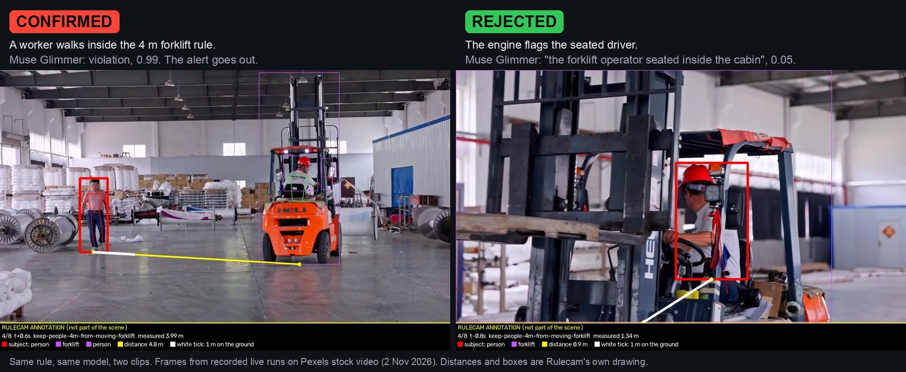

# Rulecam

[](https://github.com/jeevithg090/Axi0N_Meta/actions/workflows/ci.yml)
[](LICENSE)
[](.python-version)

**Tell your cameras what worries you, in plain words and in your own language. Rulecam says
honestly what a camera can and can't check, proves each rule before it goes live, has a second
Meta model look at every alert before anyone is bothered, and keeps evidence that anyone can
check.**

*Describe it. Plan it. Prove it. Trust it.* Works with a phone or the CCTV you already have.
Built during the Meta Global AI Developer Hackathon (Oct 26 – Nov 4 2026).



*Same rule, same model, two clips. The rule engine flags both. Muse Glimmer, Meta's open-weight
model on our own GPU, looks at the frames and confirms one and rejects the other. Frames from
recorded live runs ([T02 and T04 goldens](scenarios/README.md); the same verdicts in the
[1 Nov live campaign](reports/eval/2026-11-01-live-test-campaign.md)).*

## Try it now

| What | Link | What you will see |
|---|---|---|
| The 3-minute video | **TODO: link at submission** | The three worlds below, live and recorded, each labelled |
| Replay, no login, no keys | [rulecam.vercel.app/demo?demo=1](https://rulecam.vercel.app/demo?demo=1) | A recorded live run, step by step: request, plan, Rule CI, runtime, evidence. The header says **REPLAY**. It works with every GPU switched off |
| Check the evidence yourself | **Verify it in your browser** on the replay page ([/verify](https://rulecam.vercel.app/verify)) | Your browser recomputes every SHA-256 of the evidence log and its Merkle root. Nothing is trusted from us |
| The live app | [rulecam.vercel.app](https://rulecam.vercel.app) | The cockpit on the deployed stack. The header says **LIVE**. GPUs scale to zero when idle, so the first check can take a few minutes |
| Run it on your laptop | `cd ui && npm ci && npm run dev`, then open `localhost:3000/demo?demo=1` | The same replay, offline |

## One engine, three worlds

One set of parts serves all three: **SAM 3.1** sees, **Muse Spark** plans and reasons, **Muse
Glimmer** checks, and a **hash-chained log** keeps the proof. Each world starts from a sentence
the owner says or types.

| World | The owner says | What Rulecam does | One proof number |
|---|---|---|---|
| **Supermarket** | "Which checkout lane was busier?" | Muse Spark picks its own tools: SQL over SAM 3.1 tracks, SAM 3.1 counts, Glimmer looking at frames, Spark watching the clip. It answers in the owner's language and says which time it covered. Also: shelf gaps, local food-recall context with checked sources, advice cards, and Chain Mode for many stores | **13 of 13** owner questions answered live on real checkout video; **10** fully right, 3 partly right, checked by eye against the video ([report](reports/eval/2026-11-01-supermarket-ask.md)) |
| **Warehouse** | "Mantener a las personas a al menos 4 metros de una carretilla elevadora en movimiento." | Plans the rule, measures real distances, attacks the rule in Rule CI, has Glimmer check each alert, queues the warning in Spanish, chains the evidence. A worker can dispute an alert, and a false alarm becomes a permanent test. Muse Code can write a new rule type, and a Z3 solver proves four properties of it | Glimmer **0.98** on the Spanish rule and **0.99** on the worker **2.90 m** from a moving forklift; **0.05** on the seated driver, so no alert; **19.0 s** from event to verified decision ([report](reports/eval/2026-11-01-live-test-campaign.md)) |
| **Crowd crush early warning** | A Hindi instruction: warn us before the crowd at the gate becomes dangerous, tell stewards what to do, announce calmly in Hindi and English | SAM 3.1 counts heads in each zone and turns them into people per m². Muse Spark judges the level and writes staff actions and calm announcements, which are turned into speech in both languages. Glimmer gets 20 s to check, and a slow check never holds back a safety warning | On real footage of the Jülich bottleneck experiment (75 people, published trajectories), SAM 3.1 found **95–99%** of the true heads; gate density was within about **10%** (the reading that escalated to critical: 8.0 people/m², truth 8.0); reading to alert about **40 s** ([report](reports/eval/2026-11-03-crowd-live.md)) |

Each number is the one we measured, including the weak ones. The limits are
[below](#honest-limits).

## Why trust it

Other products already let you search or set camera alerts in plain words (Verkada, Hakimo,
Spot AI, Brivo, Conntour). Rulecam's difference is **proof**:

1. **It says what it can't see.** Before a rule goes live, the planner probes the camera and
   reports what it can and can't check. Asked to keep people away from a forklift on a kitchen
   camera, it said "I can't see the forklift reliably (lower bound 0.00)"
   ([T08](reports/eval/2026-11-01-live-test-campaign.md)).
2. **Rule CI proves each rule first.** Like tests for code: it attacks the rule with edge
   cases and broken copies of itself (mutants). The golden forklift run passed **16 of 16** edge
   cases and caught **6 of 6** mutants ([scenarios](scenarios/warehouse_driver.expected.json)).
3. **Every alert is checked.** Muse Glimmer looks at a strip of frames before anyone is told,
   and it can say no.
4. **Evidence anyone can verify.** Every event, verdict and action goes into a hash-chained log
   with a daily Merkle root (one fingerprint for the whole day). Your browser can recompute it.
5. **Workers have a voice.** Every rule is on a QR poster page. Anyone can dispute an alert. A
   false alarm becomes a permanent Rule CI test, so the same mistake cannot come back unnoticed.
6. **Privacy.** No face recognition, ever. Faces are blurred in evidence by default. The model
   that looks at alert frames runs on our own GPU. Our hosted Meta API key is set to the
   Standard tier, never the Contributor tier, under which Meta may train on inputs
   ([`.env.example`](.env.example)). Every measured run here used public stock or research video.
7. **Cameras you already own.** A phone pairs with a QR code; CCTV comes in over RTSP.
8. **Any language.** A Spanish rule, a Hindi instruction, a Spanish question answered in
   Spanish.

## Meta models: what each one does, and whether it is live

**Live** means the deployed app calls it today. **Built** means the code is written and tested,
but the deployed app does not call it yet.

| Model | Its job in Rulecam | Status |
|---|---|---|
| **Muse Spark 1.3** (1.2 for video) | Plans and compiles rules; runs the Ask agent's tool loop; judges crowd levels and writes announcements; finds shelf gaps; web search where every kept item must cite a page the search really returned | **Live** in the planner and Ask. Crowd watch ran live on the API pod on 3 Nov. Shelf gaps and web context ran live from a laptop on 3 Nov |
| **SAM 3.1** | Surveys the scene, probes what the camera can detect, tracks people and objects, counts heads, confirms shelf gaps hold no product | **Live**, hosted by Meta and self-hosted on our RunPod serverless GPU |
| **Muse Glimmer 30B** (open weights) | Checks every alert; translates each rule back into plain words; Ask's eyes | **Live**, in llama-server on our own RunPod serverless GPU |
| **Muse Voice Transcribe** | Spoken requests | **Live** |
| **Muse Code** | Writes the code for new rule types; a Z3 solver then proves four safety properties or returns a counterexample | **Built** and merged (add-on 7) |
| **Muse Spark Open** (open weights) | Second check on alerts (Tier 2), plan audit, dispute review | **Built**; not live, because the deployment has no working Baseten key |
| **Llama Prompt Guard 2** | Firewall for text found in the scene (a sign saying "ignore the rules") | **Built**; degraded until our account gets the gated model |
| **Muse Image** | Rule CI test scenes; test images for the site tools | **Built**; switched off in the app. Its test images are always labelled as generated |
| **MMS-TTS** (Meta FAIR) | Spoken warnings in the listener's language | **Live** in crowd watch (Hindi and English audio on 3 Nov); warehouse warnings are dry-run |
| **DINOv2** (Meta FAIR) | Joins an object's track pieces into one identity for Ask | **Live** in prototype mode only |

The full map, with where each model runs, is in [Model map](#model-map).

## How it works

1. **Describe.** The owner types or says a concern. Muse Spark turns it into a plan: what to
   watch, on which camera, and what a camera cannot check.
2. **Plan.** SAM 3.1 surveys the scene and probes how often it can see what the rule needs.
   The planner measures metres on the floor, then writes the rule in a typed rule language
   (Rule IR) that a rule engine runs. Glimmer reads the rule back in plain words.
3. **Prove.** Rule CI attacks the rule. A person approves the plan with every check on screen.
4. **Watch.** The camera sends 3-second video chunks. SAM 3.1 finds people and objects on our
   GPU, a tracker follows them, and the rule engine checks the rule on every keyframe.
5. **Check.** When the rule fires, Glimmer looks at a strip of frames and says yes, no or
   unsure. Safety-first policy decides what happens next.
6. **Act and record.** Alerts go to Telegram, WhatsApp, a webhook or a speaker (dry-run by
   default). Everything goes into the hash-chained log.

## Results

<!-- BEGIN RESULTS (generated by `uv run rulecam eval results`; do not edit) -->

Measured on the deployed stack and on public hand-labelled footage. Each row is read from the result file it cites by `uv run rulecam eval results`, with its run, date and the commit that recorded it; a test fails if a number here is not in that file. Weak results are shown as measured. The verifier is not yet scored against human labels (the blind labelling kit is in `eval/README.md`); more in [`eval/RESULTS.md`](eval/RESULTS.md).

| Measured | Value | Run | Date | Git SHA | Source |
|---|---|---|---|---|---|
| Distance measured, worker passing a moving forklift | 2.90 m | live test campaign, run 2: T02 | 2026-11-01 | `87d6cea` | [`2026-11-01-live-test-campaign.json`](reports/eval/2026-11-01-live-test-campaign.json) |
| Glimmer P(violation), worker inside the 4 m rule (verified alert) | 0.99 | live test campaign, run 2: T02 | 2026-11-01 | `87d6cea` | [`2026-11-01-live-test-campaign.json`](reports/eval/2026-11-01-live-test-campaign.json) |
| Event to verified decision | 19.0 s | live test campaign, run 2: T02 | 2026-11-01 | `87d6cea` | [`2026-11-01-live-test-campaign.json`](reports/eval/2026-11-01-live-test-campaign.json) |
| Glimmer P(violation), same rule asked in Spanish (warning queued in Spanish) | 0.98 | live test campaign, run 2: T03 | 2026-11-01 | `87d6cea` | [`2026-11-01-live-test-campaign.json`](reports/eval/2026-11-01-live-test-campaign.json) |
| Glimmer P(violation), seated driver flagged by the engine (rejected, no alert) | 0.05 | live test campaign, run 2: T04 | 2026-11-01 | `87d6cea` | [`2026-11-01-live-test-campaign.json`](reports/eval/2026-11-01-live-test-campaign.json) |
| Request to plan ready (planner, live models) | 133.6 s | live test campaign, run 2: T02 | 2026-11-01 | `87d6cea` | [`2026-11-01-live-test-campaign.json`](reports/eval/2026-11-01-live-test-campaign.json) |
| SAM 3.1 per 3 s chunk, p95 (self-hosted GPU) | 2.07 s | live test campaign, run 2: T02 | 2026-11-01 | `87d6cea` | [`2026-11-01-live-test-campaign.json`](reports/eval/2026-11-01-live-test-campaign.json) |
| Seconds with the exact people count (real CCTV, hand labels) | 22.7% | CAVIAR corridor, phone-68 | 2026-11-02 | `87d6cea` | [`2026-11-02-corridor-ground-truth.json`](reports/eval/2026-11-02-corridor-ground-truth.json) |
| Seconds with the count within one person | 53.4% | CAVIAR corridor, phone-68 | 2026-11-02 | `87d6cea` | [`2026-11-02-corridor-ground-truth.json`](reports/eval/2026-11-02-corridor-ground-truth.json) |
| Peak people at once, system vs labels | 10 vs 8 | CAVIAR corridor, phone-68 | 2026-11-02 | `87d6cea` | [`2026-11-02-corridor-ground-truth.json`](reports/eval/2026-11-02-corridor-ground-truth.json) |
| Person tracks and identities vs labelled visits | 416 tracks, 39 identities vs 80 visits | CAVIAR corridor, phone-68 | 2026-11-02 | `87d6cea` | [`2026-11-02-corridor-ground-truth.json`](reports/eval/2026-11-02-corridor-ground-truth.json) |
| Backfill of recorded chunks (tracked points in seconds) | 5301 points in 409 s | CAVIAR corridor, phone-68 | 2026-11-02 | `87d6cea` | [`2026-11-02-corridor-ground-truth.json`](reports/eval/2026-11-02-corridor-ground-truth.json) |
| Glimmer decisive before the strip renderer existed | 0 of 10 candidates | first recorded run (warehouse driver only) | 2026-10-31 | `79bd84a` | [`2026-10-31.json`](reports/eval/2026-10-31.json) |
| Person tracking, HOTA / IDF1 vs CAVIAR labels: ByteTrack, SAM detections at 0.5 and up | 0.239 / 0.240 | CAVIAR corridor tracks, morning backfill (ByteTrack) | 2026-11-02 | `1786ad2` | [`2026-11-02-corridor-tracking-before.json`](reports/eval/2026-11-02-corridor-tracking-before.json) |
| ID switches per minute, same run | 19.6 | CAVIAR corridor tracks, morning backfill (ByteTrack) | 2026-11-02 | `1786ad2` | [`2026-11-02-corridor-tracking-before.json`](reports/eval/2026-11-02-corridor-tracking-before.json) |
| Person tracking, HOTA / IDF1, same footage: ByteTrack with SAM detections down to 0.1 | 0.223 / 0.217 | CAVIAR corridor tracks, re-tracked with ByteTrack at the 0.1 floor (add-on 2.1) | 2026-11-02 | `1786ad2` | [`2026-11-02-corridor-tracking-bytetrack.json`](reports/eval/2026-11-02-corridor-tracking-bytetrack.json) |
| ID switches per minute, same run | 21.2 | CAVIAR corridor tracks, re-tracked with ByteTrack at the 0.1 floor (add-on 2.1) | 2026-11-02 | `1786ad2` | [`2026-11-02-corridor-tracking-bytetrack.json`](reports/eval/2026-11-02-corridor-tracking-bytetrack.json) |
| Our HOTA vs TrackEval's on the same segment (scorer cross-check) | 0.2603 vs 0.2603 | CAVIAR TwoEnterShop1cor, our scorer vs TrackEval | 2026-11-02 | `1786ad2` | [`2026-11-02-trackeval-crosscheck.json`](reports/eval/2026-11-02-trackeval-crosscheck.json) |
| Same strips replayed (8 raw frames at 960 px), verdicts matching the 1 Nov ones | 27 of 29 | Glimmer replay of the 1 Nov campaign strips | 2026-11-02 | `8bb65e3` | [`2026-11-02-verifier-replay-summary.json`](reports/eval/2026-11-02-verifier-replay-summary.json) |
| Decisive verdicts that flip with 6 face-blurred frames at 640 px instead | 6 of 29 | Glimmer replay of the 1 Nov campaign strips | 2026-11-02 | `8bb65e3` | [`2026-11-02-verifier-replay-summary.json`](reports/eval/2026-11-02-verifier-replay-summary.json) |
| Glimmer median per strip, 8 raw at 960 px vs 6 blurred at 640 px | 10898 ms vs 8505 ms | Glimmer replay of the 1 Nov campaign strips | 2026-11-02 | `8bb65e3` | [`2026-11-02-verifier-replay-summary.json`](reports/eval/2026-11-02-verifier-replay-summary.json) |
| Verdicts unchanged with a reasoning budget of 0 tokens (llama.cpp ignores the budget; reasoning stays short) | 20 of 20 | Glimmer reasoning-budget sweep | 2026-11-02 | `1786ad2` | [`2026-11-02-glimmer-budget-sweep.json`](reports/eval/2026-11-02-glimmer-budget-sweep.json) |
| Fights, "Alert me if people start fighting": found, missed, false alerts | 0 found, 4 missed, 0 false alerts | CAVIAR lobby clips (384x288, overhead), live rule runs | 2026-11-02 | `1786ad2` | [`2026-11-02-caviar-inria-events.json`](reports/eval/2026-11-02-caviar-inria-events.json) |
| Fight candidates on Fight_Chase, every one rejected by Glimmer as no visible fight | 8 candidates, 0 alerts | CAVIAR lobby clips (384x288, overhead), live rule runs | 2026-11-02 | `1786ad2` | [`2026-11-02-caviar-inria-events.json`](reports/eval/2026-11-02-caviar-inria-events.json) |
| Falls, "Tell me if anyone falls down": found, missed, false alerts | 0 found, 2 missed, 0 false alerts | CAVIAR lobby clips (384x288, overhead), live rule runs | 2026-11-02 | `1786ad2` | [`2026-11-02-caviar-inria-events.json`](reports/eval/2026-11-02-caviar-inria-events.json) |
| Left bags and boxes: found, missed, false alerts | 0 found, 3 missed, 0 false alerts | CAVIAR lobby clips (384x288, overhead), live rule runs | 2026-11-02 | `1786ad2` | [`2026-11-02-caviar-inria-events.json`](reports/eval/2026-11-02-caviar-inria-events.json) |
| Shop entries, "Let me know each time someone walks into one of the shops": found, missed, false alerts | 0 found, 19 missed, 0 false alerts | CAVIAR corridor clips, live rule runs | 2026-11-02 | `1786ad2` | [`2026-11-02-caviar-corridor-events.json`](reports/eval/2026-11-02-caviar-corridor-events.json) |
| One alert check on warm GPUs (SAM 3.1 on a 3 s chunk, then Glimmer on its strip), total | 28.7 s | Serverless load test (SAM chunk + Glimmer strip per check) | 2026-11-02 | `1786ad2` | [`2026-11-02-serverless-load.json`](reports/eval/2026-11-02-serverless-load.json) |
| 20 alert checks at once on warm GPUs, total p50 / p95 | 36.0 s / 51.9 s | Serverless load test (SAM chunk + Glimmer strip per check) | 2026-11-02 | `1786ad2` | [`2026-11-02-serverless-load.json`](reports/eval/2026-11-02-serverless-load.json) |
| GPU cost per alert check, 20 at once (RunPod serverless, billed worker time) | $0.0039 | Serverless load test (SAM chunk + Glimmer strip per check) | 2026-11-02 | `1786ad2` | [`2026-11-02-serverless-load.json`](reports/eval/2026-11-02-serverless-load.json) |
| Checks answered within 300 s after SAM scaled to zero (1 and 5 at once; Glimmer stayed warm) | 0 of 1, 4 of 5 | Serverless load test (SAM chunk + Glimmer strip per check) | 2026-11-02 | `1786ad2` | [`2026-11-02-serverless-load.json`](reports/eval/2026-11-02-serverless-load.json) |
| Ask's graded numbers within tolerance of the hand labels | 7 of 36 | Ask benchmark, CAVIAR corridor, 10 questions x 3 runs (`rulecam eval ask`) | 2026-11-02 | `1786ad2` | [`2026-11-02T230520Z-corridor.json`](reports/eval/ask/2026-11-02T230520Z-corridor.json) |
| Ask's median answer time | 41.8 s | Ask benchmark, CAVIAR corridor, 10 questions x 3 runs (`rulecam eval ask`) | 2026-11-02 | `1786ad2` | [`2026-11-02T230520Z-corridor.json`](reports/eval/ask/2026-11-02T230520Z-corridor.json) |
| "How many went into a shop?" (truth: 24), the three runs' answers | 14, 11, 32 | Ask benchmark, CAVIAR corridor, 10 questions x 3 runs (`rulecam eval ask`) | 2026-11-02 | `1786ad2` | [`2026-11-02T230520Z-corridor.json`](reports/eval/ask/2026-11-02T230520Z-corridor.json) |
| MOT17 HOTA by TrackEval, lowest (MOT17-13) and highest (MOT17-04) sequence; keyframes only, so not directly comparable with published trackers | 0.203 to 0.450 | MOT17 training set, 7 sequences, SAM 3.1 keyframes at 10 per second + ByteTrack (0.1 floor) | 2026-11-03 | `1786ad2` | [`2026-11-02-mot17.json`](reports/eval/2026-11-02-mot17.json) |

<!-- END RESULTS -->

The crowd and supermarket numbers above come from the
[crowd](reports/eval/2026-11-03-crowd-live.md) and
[supermarket](reports/eval/2026-11-01-supermarket-ask.md) reports, which are not in this
generated table yet. An earlier E3 figure came from a simulated harness and was withdrawn on
Oct 31 (see [`eval/RESULTS.md`](eval/RESULTS.md)).

## Honest limits

- **Ask's counts are not accurate yet.** On hand-labelled CCTV, 7 of 36 graded numbers were
  within tolerance. Asked "how many went into a shop?" (truth: 24), three runs said 14, 11
  and 32.
- **Low-resolution overhead footage beats some rules.** On CAVIAR clips (384x288) shop entries,
  fights, falls and left bags were all missed. There were no false alerts either.
- **Tracking is weak in crowds.** HOTA 0.239 against CAVIAR labels, with 19.6 ID switches a
  minute. Crowd watch counts heads in each reading instead of following people.
- **Crowd watch: Glimmer was not checked live.** On 3 Nov no GPU was free, so the alerts went
  out unchecked after 20 s, as designed. The warning came at the first reading, but the corridor
  zone's density read 22% low because it reached past the marked floor points.
- **Cold starts are slow.** After SAM scaled to zero, 0 of 1 and 4 of 5 checks finished within
  300 s.
- **Not live yet:** Spark Open as Tier 2, Prompt Guard 2, Muse Image scenes in Rule CI, spoken
  warehouse warnings. Chain Mode's demo numbers are simulated and labelled SIMULATED.
- **Prototype mode is on in the hackathon deployment.** See
  [What we claim, and what we don't](#what-we-claim-and-what-we-dont).
- **Rulecam is not a safety system of record.** It helps people watch. It does not replace a
  guard, a lock-out or a supervisor.

---

## More detail

### The problem

- **Cameras are everywhere, but nobody is watching.** One retailer found that less than 1% of
  its recorded video is ever viewed
  ([Security Magazine](https://www.securitymagazine.com/articles/76977-so-why-isnt-shrink-shrinking-1)).
  A small site has cameras, but no safety team to watch them, write rules for them, or check
  that an alert is real.
- **Forklifts hurt people every day.** OSHA counts about **85 deaths and 34,900 serious
  injuries a year** from forklifts in the US
  ([OSHA, Powered Industrial Trucks notice](https://www.osha.gov/sites/default/files/enforcement/directives/reg1_fy2018_cpl-04-00-023e_powered-industrial-trucks.pdf)).
  One in four blue-collar workers saw a near miss in the past year and didn't report it
  ([TRADESAFE survey](https://trdsf.com/blogs/news/workplace-safety-silence-reporting-risks)).
- **Language matters.** In 2024 Hispanic or Latino workers died at work at 4.3 per 100,000
  full-time workers, against 3.3 for all workers
  ([BLS](https://www.bls.gov/news.release/cfoi.nr0.htm)). OSHA requires training in a language
  workers understand.
- **Empty shelves and queues cost sales.** Out-of-stocks cost about 7.4% of retail sales in
  2021, per NielsenIQ data
  ([report](https://a-closer-look.com/wp-content/uploads/2024/09/Report-Out-of-Sight-Out-of-Mind-The-Hidden-Cost-of-Empty-Shelves-and-Broken-Displays_FINAL-sm.pdf)).
- **Crowds get dangerous before anyone can see it from the ground.** In a crush, nobody does
  anything wrong. People are packed so tightly that they can no longer move by choice. Inquiries
  keep finding the same thing: the warning existed, and it did not become action
  ([our research, with sources](docs/pitch/research/crowd.md#what-repeats)). A camera looking
  down can count, and an alert can name who does what next.
- **Trust is the gap.** Plain-language camera alerts already exist. What owners, workers and
  insurers can't get is a way to check that a rule works and an alert is real
  ([market research](docs/pitch/research/)).

### Who it helps

- **A small warehouse** with forklifts and no safety officer.
- **A supermarket owner** who wants to know about queues, empty shelves and busy hours, across
  one store or many.
- **A venue, station or festival** that wants a warning before the crowd at a gate gets too
  dense.
- **The crew.** They see every rule on a QR poster page, can dispute an alert with one tap, and
  are never recognised by face.

### For judges: the 2-minute path

| Time | Open | What to look for |
|---|---|---|
| 0:00 | [`/demo?demo=1`](https://rulecam.vercel.app/demo?demo=1) | The owner's plain-language request, the planner's steps, the compiled rule and its acceptance trace |
| 0:30 | the Rule CI section of the same page | The rule was attacked with boundary scenes and mutants before anyone could approve it, re-run offline in CI |
| 0:50 | **Verify it in your browser** | Your browser recomputes every SHA-256 of the evidence chain and its Merkle root |
| 1:20 | [Results](#results), then [`reports/eval/`](reports/eval/) | Live runs on real video and on hand-labelled CCTV, every number tied to its run, date and commit |
| 1:45 | [Model map](#model-map) | Which Meta model does which job, and where it runs |

> **Built during the hackathon.** Everything in this repository was written between Oct 26 and
> Nov 4 2026. [`WHAT-WE-BUILT.md`](WHAT-WE-BUILT.md) lists every module with the pull request
> that added it, and every reused library or model with its licence.

### How we use Meta models, beyond a basic call

- **Muse Spark is an agent with a fixed set of steps.** It turns a sentence into a plan, asks
  clarifying questions, grounds each rule in a standard (OSHA, FDA Food Code), and compiles it
  into Rule IR: survey, probe, calibrate, compile, check, repair.
- **Muse Spark answers questions about what the cameras saw.** The Ask agent runs a tool loop:
  SQL over SAM 3.1 tracks, SAM 3.1 counts on recorded frames, Glimmer looking at frames with
  numbered boxes, and Spark 1.2 watching the recorded clip as video.
- **Muse Spark searches the web, and we check every source.** For site context (weather,
  events, food recalls) an item is kept only if its source is a page the search really
  returned ([site tools report](reports/eval/2026-11-03-site-tools-live.md)).
- **Muse Spark and SAM 3.1 check each other.** On shelves, Spark proposes empty facings and SAM
  3.1 confirms no product package is inside each one. In crowds, SAM counts and Spark judges.
- **Muse Glimmer, open weights, on our own GPU.** The Tier 1 verifier runs in llama-server on a
  RunPod serverless RTX 4090 behind a load balancer we built. It also translates each rule back
  into plain words, so the owner can check it says what they meant.
- **Muse Code writes code, and a solver proves it.** For a rule type the engine does not have,
  Muse Code writes a check. Rulecam runs it in a sandbox, tests it on generated scenes and
  broken copies, and has the Z3 solver prove four properties for every valid scene with up to
  three objects: no alert without the target object, never crashes, moving the whole image
  changes nothing, and a declared move never turns an alert off. Anything it cannot prove
  exactly is marked unsupported, never proved.

### What it does, step by step

1. **Describe it.** The owner types or says what worries them. Muse Spark plans the job: what
   to watch, which camera covers it, and what a camera *cannot* check. The feasibility screen
   says so before anything goes live.
2. **Plan it.** The planner looks at the scene with SAM 3.1, measures real distances, and
   writes the rule in Rule IR. It shows the plan, what changed since the last approved plan,
   and every check it passed.
3. **Prove it.** Rule CI attacks every rule with edge-case scenes and mutants before the owner
   can approve it. By default, a rule that fails Rule CI cannot go live. In prototype mode (on
   in the hackathon deployment) a failed check is shown as an amber caveat instead.
4. **Trust it.** Before anyone is alerted, Muse Glimmer looks at a strip of frames from the
   event and says yes, no or unsure (Tier 1). Every event, verdict, action and acknowledgement
   goes into a hash-chained log with a daily Merkle root. Anyone can check it in the browser,
   with no server.

### Architecture

```mermaid
flowchart LR
  owner([Owner]) -- "plain-language request" --> planner["Planner<br/>Muse Spark"]
  planner -- "survey and probes" --> samh["SAM 3.1<br/>hosted API"]
  planner --> ci["Rule CI<br/>boundary scenes, mutants"]
  ci --> approve{"Owner approves<br/>the plan"}
  phone([Phone or camera]) -- "3 s H.264 chunks" --> api["FastAPI runtime<br/>(RunPod CPU pod)"]
  approve --> api
  api -- "keyframes" --> sam["SAM 3.1<br/>serverless GPU"]
  sam --> tracks[("Track store<br/>BoT-SORT people, ByteTrack objects")]
  tracks --> engine["Rule engine<br/>typed Rule IR"]
  engine -- "candidate + evidence strip" --> glimmer["Muse Glimmer<br/>Tier 1, serverless GPU"]
  glimmer --> policy["Verification policy"]
  policy --> actions["Alerts and actions<br/>(dry-run by default)"]
  policy --> chain[("Hash-chained<br/>evidence log")]
  chain --> verify["Browser verify page<br/>Merkle root"]
  owner -- "questions" --> ask["Ask agent<br/>Muse Spark"]
  ask --> tracks
  ask --> sam
  ask --> glimmer
  sam -- "/embed crops" --> ids["Identities: OSNet-AIN people,<br/>DINOv2 objects (prototype mode)"]
  ids --> ask
```



### Model map

Which model does which job, where it runs, and how far it is wired today. **Live** means the
deployed app calls it. **Library** means the code is built and tested, but the live app does not
call it yet. **Planned** means it is not built.

| Meta model | Job | Runs where | Status |
|---|---|---|---|
| Muse Spark 1.3 (+1.2 for narrated video) | Planner, compiler, standards grounding, Ask agent, crowd warden | Hosted API | Live in the Planner (P2-01, P2-06) and in `POST /ask`, where Spark 1.2 can also watch a joined clip of the window it picks (`watch`, add-on 2.8). Crowd watch (`crowd/warden.py`) ran live on the API pod on 3 Nov. Site tools (run live from a laptop on 3 Nov, not yet on the deployed stack): `/context` uses its **web search** with the raw results returned, and keeps an item only if its source is a page the search returned; `/crowd` has it **watch the clip** of each crowded spell; `/shelf` uses its **image understanding** to find shelf gaps |
| Muse Voice Transcribe | Spoken requests, disputes, voice round-trip check | Hosted API | Live for spoken requests (P2-02); voice disputes are library (P2-S2), not yet passed to the worker router |
| SAM 3.1 | Survey, probes, tracking, coverage, masks, head counts | Hosted API; self-hosted on a RunPod serverless GPU (RTX 4090) | Live: hosted client (P1-02) for survey, probes and Rule CI; the runtime sends keyframes to our self-hosted SAM 3.1 (`SAM_BASE_URL`, a RunPod serverless load balancer since 2 Nov) and falls back to hosted (P1-03). Crop-zoom (add-on 3.3) re-runs it on enlarged head and hand crops for worn items. Crowd watch counts heads per zone with it |
| Muse Glimmer 30B (open weights) | Tier 1 verifier, back-translation, recompute, Ask's eyes, crowd check | llama-server on a RunPod serverless GPU (RTX 4090) | Live as Tier 1 (P3-03). By default it sees 6 face-blurred keyframes at 640 px (P4-05); the deployed **prototype mode** sends 8 raw frames at 960 px |
| Muse Code | Writes new rule-type checks (`extensions/`), proved with Z3 (add-on 7) | Hosted, headless | Library: merged, owner-only `/extensions` routes and page |
| Muse Spark Open (open weights) | Tier 2 verifier, dispute review, plan audit, devil's advocate | Baseten | Wired for plan audit, dispute review (P2-07, P2-11) and the review of each Ask answer (add-on 2.7); Tier 2 in the runtime is library (P3-04). The hackathon deployment has no working Baseten key yet, so these calls are skipped and logged (`plan_audit_skipped`) |
| Muse Image | Rule CI scenes, lookalikes, boundary pairs, Z3 counterexample drawings | Hosted API | Library: Rule CI part 2 (P2-09, #71) is built but switched off in the app |
| MMS-TTS (FAIR) | Spoken warnings | CPU | Live in crowd watch (Hindi and English WAVs on 3 Nov). Warehouse actions are dry-run and record "would play the warning (es)" |
| Llama Prompt Guard 2 (86M) | Scene-text firewall | CPU (transformers, `ml` extra) | Wired into the runtime's verification (P3-05, #105); it needs `HF_TOKEN` and the `ml` extra, and without them the runtime reports the firewall as degraded, which it is in the hackathon deployment |
| DINOv2 (FAIR) | Joins an object's track fragments into one identity for Ask | `/embed` on the SAM serverless GPU | Live in prototype mode only (`ask/identity.py`) |
| Sapiens (FAIR) | Pose and skeletons | GPU | Planned. Meanwhile RTMPose-l body7 (OpenMMLab, ONNX on the API pod's CPU) draws each person's pose into the evidence strips (add-on 3.4) |
| V-JEPA 2 (FAIR) | Surprise Lens world model | GPU | Planned (gated) |

Other models in the pipeline, picked on quality and speed: **OSNet-AIN** person re-ID vectors
(BoxMOT, on the SAM GPU) feed **BoT-SORT**, which tracks people between SAM keyframes, and Ask's
person identities (prototype mode only, body crops, never faces); objects stay on ByteTrack. In
the hackathon deployment people are on ByteTrack too (`RULECAM_PERSON_TRACKER=bytetrack`) until
the GPU volume carries the fix for OSNet under SAM's bfloat16 autocast. **MoGe-2** (Microsoft,
on the SAM GPU) gives the planner a metric ground calibration from one frame (add-on 3.5).

### Documents

| File | Purpose |
|---|---|
| [`SUBMISSION.md`](SUBMISSION.md) | The hackathon submission text |
| [`docs/video/script.md`](docs/video/script.md) | The 3-minute video: shot list, voiceover, captions, fallbacks |
| [`docs/pitch/deck.md`](docs/pitch/deck.md) | The 10-slide finals deck with speaker notes |
| [`docs/pitch/launch.md`](docs/pitch/launch.md) | Launch posts and the 30-second vertical cut |
| [`docs/DEMO.md`](docs/DEMO.md) | The live demo script and the golden REPLAY |
| [`docs/TASKS.md`](docs/TASKS.md) | Full team task book: rules, contracts, gates, every task |
| [`docs/master-plan.md`](docs/master-plan.md) | Product plan (v3): proof stack, use cases, evaluation |
| [`docs/v2-design.md`](docs/v2-design.md) | Engine internals: Rule IR, perception, Rule CI, verifier, privacy |
| [`docs/site-advisor.md`](docs/site-advisor.md) | Site Advisor: business advice you can check |
| [`src/rulecam/chain/README.md`](src/rulecam/chain/README.md) | Chain Mode: one rule pack for many stores |
| [`docs/deploy.md`](docs/deploy.md) | Deployment: Vercel UI, RunPod API, Glimmer and SAM |
| [`WHAT-WE-BUILT.md`](WHAT-WE-BUILT.md) | What we wrote during the hackathon vs. what we reused, with licences |
| [`evidence/`](evidence/README.md) | Screenshots and verify-page captures behind our claims |
| [`eval/RESULTS.md`](eval/RESULTS.md) | Measured evaluation results |

### Quick start

```bash
make setup        # uv sync + pre-commit hooks
cp .env.example .env
make check        # lint + types + tests + coverage floors — must pass before every push
uv run rulecam version
```

Requires Python 3.12 (via `uv`), `ffmpeg`, and Node 20+ for the UI.

```bash
cd ui && npm ci && npm run dev          # the web UI on http://localhost:3000
uv run rulecam chain demo chains/kitchen-basics   # Chain Mode, no models, about 10 s
```

- **Without keys:** open `http://localhost:3000/demo?demo=1`. It replays a recorded live run
  (labelled REPLAY in the header) with no model calls. Nothing in it is hand-written.
- **Live:** copy `.env.example` to `.env`, fill in the Meta Model API key and the Glimmer and SAM
  endpoints, then follow [`docs/deploy.md`](docs/deploy.md). The header badge reads LIVE.
- **Check an evidence log:** `uv run rulecam audit <YYYY-MM-DD> <site>` re-verifies a day's
  chain and re-derives every decision; or drop the chain file on the browser verify page.

### How we work

Code, pull requests and **CI all live on GitHub** (GitHub Actions, `.github/workflows/ci.yml`:
the `check`, `guardrails` and `ml-cpu` jobs). Every task ends in a pull request with all checks
green; see `docs/TASKS.md` §0 and §3.4, and `CLAUDE.md`.

### What we claim, and what we don't

- **We claim** what `eval/RESULTS.md`, `reports/eval/`, the golden runs and `evidence/` show,
  and nothing more. Every number in the UI and in the video comes from a run you can replay.
  The hand-made sample data used to build the cockpit screens (`scripts/seed_live_backend.py`)
  is not a run, and we never quote it as a result.
- **REPLAY is never shown as LIVE.** The header badge says which one you are watching, and it
  never switches silently.
- **The verifier can say no.** Glimmer and Spark Open can reject a candidate; safety-critical
  rules fail towards alerting a human, never towards silence. In crowd watch, a verifier that
  does not answer in 20 s never holds back the warning.
- **Rulecam is not a safety system of record.** It helps people watch; it does not replace a
  guard, a lock-out or a supervisor. Interlocks (Kasa plugs) only ever stop equipment, and only
  a human can resume it.
- **No face recognition, ever.** In the default modes faces are blurred in evidence strips, the
  anonymous and strict privacy modes keep no person pixels at all, and nobody is re-identified.
- **Prototype mode is different, and the hackathon deployment runs it**
  (`RULECAM_PROTOTYPE_MODE=true`, `src/rulecam/prototype.py`): the planner declines only
  requests that single people out by race, ethnicity, skin colour, religion, nationality,
  immigration status or sexual orientation, and compiles every other concern; every compiled
  rule activates, with failed acceptance and Rule CI checks shown as amber caveats; Glimmer sees
  the raw, unblurred frames; the verifier's verdict is final (a rejection is suppressed whatever
  the rule's severity, so the "fail towards alerting a human" point above holds only outside
  prototype mode); and `POST /ask` **re-identifies people** across track fragments by
  appearance (OSNet-AIN re-ID vectors of body crops, plus a short Glimmer note on clothing) so
  an owner can ask about visitors and dwell time. The tracker uses the same vectors to keep a
  person's track between keyframes (BoT-SORT). It never uses faces and never names anyone.
  Prototype mode is off by default and in CI.
- **Hosted models and your footage.** The hosted Meta Model API key is configured for the
  Standard tier, never Contributor (`.env.example`). The verifier that sees alert frames runs on
  open weights on our own GPU. Every measured run in this repository used public stock or
  research footage (Pexels, Mixkit, CAVIAR, MOT17, Jülich), never a real site's CCTV.

### Licences

The code in this repository was written during the hackathon and is MIT-licensed. Third-party
components are used as dependencies under their own licences; see
[`WHAT-WE-BUILT.md`](WHAT-WE-BUILT.md). Llama Prompt Guard 2 is used under the Llama 4 Community
License: **Built with Llama**. **Built with Muse Spark Open** (wired; not live in the hackathon
deployment, see the model map).
