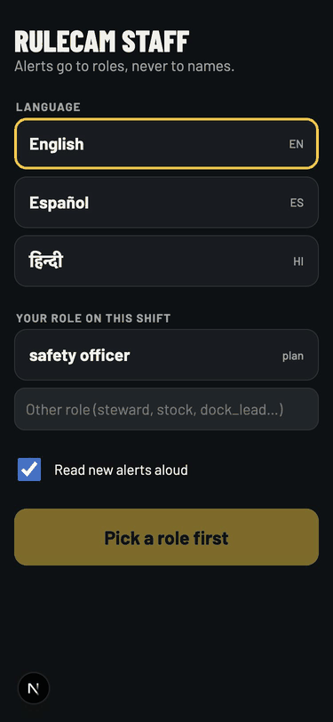
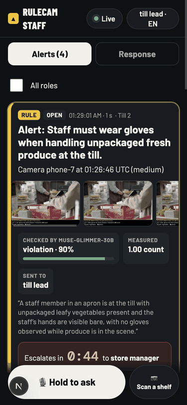
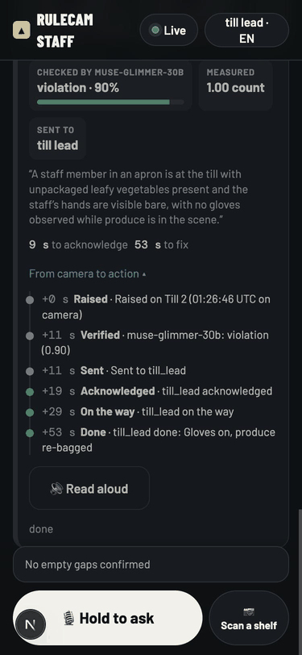
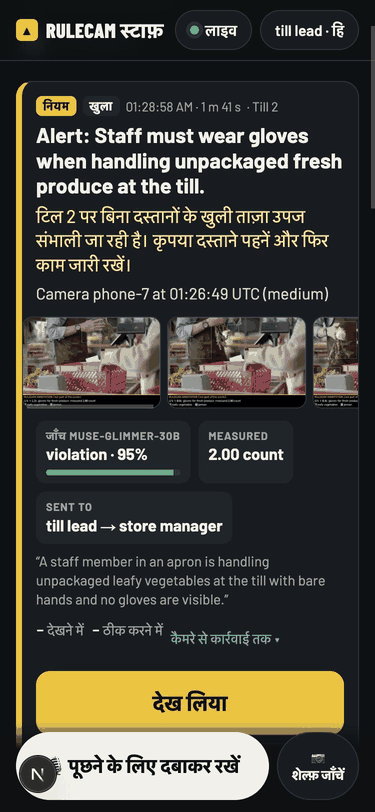
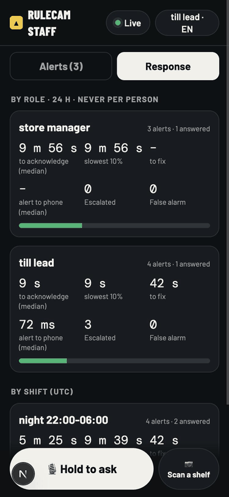

# Staff companion: camera alerts that become action

Camera AI usually sends its alerts to a dashboard that nobody is watching. The people who can
fix the problem are on the floor with a phone: store staff, warehouse leads, crowd stewards. The
staff companion is an installable phone app (a PWA at `/staff`) that puts every alert and task in
front of the right role, makes the response one tap, and times the whole loop so a manager can
see where alerts stall.

Crowd-disaster inquiries (Itaewon 2022, the Kumbh 2025 stampede, Astroworld 2021) found that
warnings existed and nobody acted on them. Retail needs proof that a hazard was fixed.
Warehouses have near misses that nobody hears about. The app is built around closing that gap.

## What a person sees

1. **First open.** They choose a language (English, Spanish or Hindi) and their role on this
   shift. The role list comes from the site's plans and from the alerts the site has sent. Alerts
   go to roles, never to names, and the app never asks who the person is. It also asks
   permission to show notifications.
2. **The feed.** Every card the role has to act on, newest and still-open first. A new alert
   buzzes the phone, plays a short tone, shows a system notification when the app is in the
   background, and is read aloud in the chosen language.
3. **A card** shows:
   - the rule in plain words, or, for a crowd warning, what the model says to do now;
   - the anonymised evidence strip (the runtime's stills, with faces blurred);
   - the verifier's judgement, for example "Checked by muse-glimmer-30b: violation, 95%", with
     its reason;
   - a live countdown such as "Escalates in 0:42 to store manager", taken from the real
     escalation timer;
   - the loop with a time for each step (raised, verified, sent, acknowledged, on the way,
     done, escalated), plus the time to acknowledge and the time to fix. Other agents' records
     for the same event, such as a retail "fixed in N min" or a crowd arrival, appear in the
     loop too;
   - big buttons: the next step (Acknowledge, then On my way, then Done), plus Done, Escalate,
     False alarm and Read aloud.
4. **Done** can carry a photo of the fix, taken with the phone camera. The photo's SHA-256 is
   chained with the tap.
5. **Escalate** moves the open chain on now, or sends the card to a role the person picks.
6. **False alarm** takes the same path as the alerts page and Telegram: an ack, a
   `false_alarm` label for rule health, and a permanent Rule CI regression for the rule.
7. **Hold to ask.** This is a push-to-talk question ("is aisle 4 still blocked?"). Only that one
   recording is sent. Muse Voice Transcribe turns it into text, the Ask agent answers (Muse Spark
   plans, SAM 3.1 counts, Glimmer looks), and the answer is spoken back. A typed question works
   too.
8. **Scan a shelf** (when shelf scans are on). A photo of a bay becomes restock tasks: Muse
   Spark finds the gaps and SAM 3.1 confirms each one is empty.
9. **Response tab.** Time to acknowledge (median and slowest 10%), time to fix, alert to phone,
   escalations and false alarms, grouped by role and by shift. Never per person.

The app works offline as a shell. The service worker caches the page, and the phone keeps the
last feed it saw, so a dead spot in the warehouse shows "Offline: last known alerts" instead of a
blank screen. Alerts are never served from cache: the API is always asked first.

## Where the items come from

- **Rule alerts and reviews.** The runtime's verified alerts and its human-queue reviews (the
  verifier was unsure, vetoed, or unreachable) reach staff through the site's `LanNotifier` and
  `EscalationManager`. The feed joins each one to the event's chained candidate, verdicts and
  escalation steps.
- **Crowd warnings.** The crowd warden sends through the same notifier, so they arrive the same
  way, with Spark's "do now" list and the announcements it spoke.
- **Drills** (`/drills`) run through the real escalation chain and show up tagged as drills.
- **Dry run.** While the site's actions run in dry run nothing is sent, but the chain says who
  *would* have been told. Those cards appear with a DRY RUN tag, so staff can rehearse.
- **After an API restart.** The notifier only keeps alerts in memory, so the feed rebuilds those
  cards from the chain's notify and escalation steps. The cards come back, but without a running
  timer.
- **Shelf tasks** come from `POST /staff/shelf`.

## API contract

Every route is mounted under `/staff`. Like `/alerts`, every route sits behind the owner check
(loopback or an owner session), because roles are self-asserted. A public deployment needs staff
sign-in in front of these routes.

| Route | What it does |
|---|---|
| `GET /staff/config` | Languages, `dry_run`, whether Ask (`ask`, `listen`) and shelf scans are on, the speech engines |
| `GET /staff/roles` | Roles the site uses, each with where it was seen (`plan`, `rule`, `crowd`, `shelf`…) |
| `GET /staff/feed?role=` | The role's items, newest first (omit `role` for every item) |
| `GET /staff/stream?role=` | Server-sent events: `snapshot` (all items, `sent_at`), then `item` for each changed item (`item`, `sent_at`), and `ping` every 15 s of quiet |
| `GET /staff/items/{id}` | One item |
| `POST /staff/items/{id}/actions` | `{action: acknowledge \| on_my_way \| done \| false_alarm \| escalate, role, note?, to_role?}` returns `{item, did}`. 404 for an unknown item; 409 for Escalate with nothing open and no `to_role` |
| `POST /staff/items/{id}/done` | Multipart `role`, `note`, `photo` (JPEG, PNG or WebP, up to 15 MB) |
| `POST /staff/items/{id}/seen` | `{role, client_ms}`: the phone showed it. Returns the server's alert-to-phone time on the first sighting |
| `GET /staff/items/{id}/speech?lang=en\|es\|hi&role=` | `{lang, text, audio, engine, model}`: Spark's spoken line and its WAV |
| `GET /staff/media/{id}/{n}` | Evidence still `n`, served only from `data/strips`, `data/crowd`, `data/shelf` and `data/staff` |
| `GET /staff/audio/{name}` | A spoken WAV |
| `GET /staff/stats?hours=24` | `{by_role, by_shift}` buckets: items, acknowledged, done, false alarms, escalated, `ack_p50_s`, `ack_p90_s`, `done_p50_s`, `phone_p50_ms`, `phone_p95_ms` |
| `POST /staff/ask` | Multipart `role`, `lang`, and either `audio` (16 or 24 kHz mono WAV) or `question`. Returns `{heard, answer, lang, audio, engine, seconds, models}` |
| `POST /staff/shelf` | Multipart `role`, `photo`. Returns the restock tasks made |

A `StaffItem` carries `item_id`, `source` (`rule`, `crowd`, `shelf`, `review` or `drill`),
`title`, `body`, `roles` (everyone told so far, in order), `severity`, `camera_id`,
`camera_name`, `rule_text`, `measurement`, `ts`, `status` (`open`, `acknowledged`, `on_my_way`,
`done` or `false_alarm`), `verdict` (`model`, `verdict`, `confidence`, `reason`, `late`),
`thumbnails`, `escalation_step`, `next_role`, `escalates_at`, `actions`, `do_now`,
`announcements`, `sample`, `dry_run`, `timeline` (each step has `stage`, `ts`, `label`, `role`
and `after_s`), `ack_s` and `fix_s`.

**Evidence chain.** Every tap is appended as an `action` record with `kind: log`,
`gate: human`, `approved_by_role`, `source: staff_app`, `staff_action`, an optional `note` and
`to_role`, and, for Done, `photo_sha256`. Acknowledge, On my way and Done also stop the
escalation through `EscalationManager.ack`, which chains an `ack`. False alarm chains the
`label`. Each tap is also published as `action.done`, so the cockpit sees it live.

## Speech

Muse Spark 1.3 writes the spoken line from the card's facts, in the chosen language and script.
The wording is not templated per rule. A speech engine then says it: Meta MMS-TTS
(`facebook/mms-tts-spa`, `-hin`, `-eng`; the same engine as the crowd announcements) when the
`ml` extra is installed, else the operating system's voice. The system voice is reported as
`system-tts`, never as Meta's. When neither engine can speak the language, the phone's own
speech synthesis reads the text.

## Demo steps (local, against the live GPU endpoints)

1. Write a worktree `.env` with `RULECAM_MODE=live`, `RULECAM_RUNTIME=true`,
   `RULECAM_PROTOTYPE_MODE=true`, `RULECAM_ACTIONS_DRY_RUN=false`, the Meta key, and the
   serverless Glimmer and SAM URLs with their keys (see `.claude/skills/rulecam-ops`).
2. `uv run uvicorn rulecam.api.app:app --port 8462`, then
   `cd ui && NEXT_PUBLIC_RULECAM_API=http://127.0.0.1:8462 npx next dev -p 3462`.
3. Open `http://localhost:3462/staff` on a phone (or in a phone-sized window), choose a
   language, type the role `till lead`, and tap Start. Use Chrome's "Install app" to add it to
   the home screen.
4. Activate a rule. The demo used `PUT /runtime/plan` with one rule: *"Staff must wear gloves
   when handling unpackaged fresh produce at the till."* Its predicate is leafy vegetables and a
   person, held for 1.5 s; its action escalates to `till_lead, store_manager` after 45 s. Word a
   rule as an obligation. Glimmer judges whether the rule is broken, so a rule that only
   describes a situation ("a customer is at the till") comes back `no_violation`
   (`reports/eval/2026-11-04-staff-app.md`).
5. Feed a clip as a paired phone camera: `POST /pair/token`, `POST /pair/{token}/claim`, then
   `POST /pair/{token}/chunk` with each 3 s MP4, one per second at most (the demo used the
   supermarket checkout clip `p8421356`).
6. SAM 3.1 finds the produce and the person, the rule fires, Glimmer checks the strip
   (`violation 0.90`: "bare hands, no gloves"), and the alert appears on the phone. It buzzes and
   is read aloud, and the countdown to the store manager runs.
7. Tap Acknowledge, then On my way, then Done with a photo. Open "From camera to action" to see
   the timed loop. `GET /incidents/{event_id}` shows the same records in the chain.
8. Let one alert run out its timer, and see it reach the store manager's phone.
9. Switch the language to Hindi: the card's line and its speech now come in Hindi.
10. Hold to ask: "how many customers were at the till in the last ten minutes?"

## Not done

- **Web Push** (VAPID). Alerts reach the phone while the app is open or in the background tab:
  an SSE stream with a buzz, a tone, a system notification and speech. A phone whose browser
  has killed the page gets nothing until it is reopened.
- **Staff sign-in.** Routes use the owner check, as `/alerts` does.
- **Handing the retail agent's restock tasks a Done photo.** Its `/retail/tasks/{id}/proof`
  checks the photo with Spark and Glimmer. The staff app could forward the photo there when
  that branch lands.
- **A voice near-miss report** for the warehouse role. The route (`/report/voice`) is not on the
  warehouse branch yet. `GET /staff/config` already carries a `near_miss_voice` flag for it, but
  the app has no button yet.
