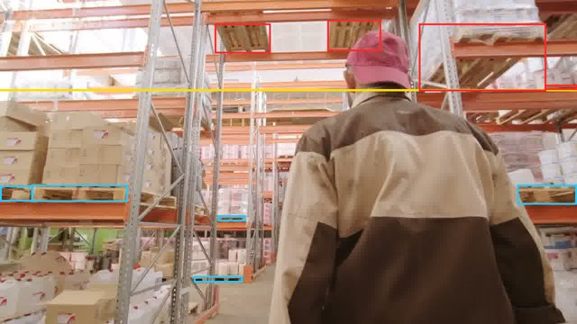
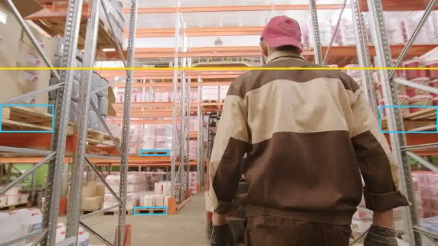

# Muse Code writes a new rule type, first live runs (4 Nov 2026)

Branch `p1/final-integration` (PR #147). Owner request, in the owner's words:

> Alert if a pallet is stacked above the yellow line on the rack

Concept `pallet`, camera `warehouse-pexels-4294434`, one owner-drawn line `yellow` from
(0, 200) to (1280, 200) px. Command (on a laptop, where the Muse Code CLI 1.4.11 is installed and
signed in):

```bash
RULECAM_MODE=record uv run rulecam extension new "Alert if a pallet is stacked above the yellow line on the rack" \
  --concept pallet --camera warehouse-pexels-4294434 --line yellow=0,200,1280,200 --name pallet_above_line
```

Every model call was live: Muse Code (`muse exec --json --model muse-spark-1.2`, Meta Model API)
wrote the check, and Muse Spark 1.3 reviewed it. Spark Open (Baseten) was not used: its key is
handled by the ops agent, so the review is the labelled Spark 1.3 fallback
(`reviewer: spark-1.3-fallback`).

## Result

After two fixes found by the first runs (below), the third run produced a version that passed
every proof step and the review. The owner approved it on the live API, and the rules engine ran
it on a real warehouse clip tracked by SAM 3.1.

| Run | Muse Code version | What the proof found | Outcome | Wall time |
|---|---|---|---|---|
| 1 | `c60fe5045b80`, 107 lines | Own tests 10/10, boundary 12/12, common sense 5/5 on 202 scenes; **mutation 34/60 (57%, need 80%)**: dozens of type checks no case reaches; Z3 could not read it (`while`, `isinstance`) | rejected, not reviewed | 188 s |
| 2, round 1 | `c3e2e43c44c1`, 23 lines | Mutation 23/24, common sense 5/5; **Z3 counterexample: a vertical yellow line divides by zero** (confirmed by a sandbox run) | rejected, not reviewed | 372 s for both rounds |
| 2, round 2 (repair) | `f76f0c43d16c`, 26 lines | Every step passed (mutation 26/27, Z3 4/4 proved) | **reviewer rejected**: it indexes schema keys without `.get` | |
| 3 | `367981606c60`, 30 lines | Validator; Muse Code's own 9 cases; Rulecam's 12 boundary cases; mutation 25/26 (96%); common sense 5/5 relations on 202 generated scenes; Z3 proved all 4 properties for every sample with up to 2 objects | **proposed** (reviewer approved, 7 reasons, 4 risks) | 249 s |

Time split for run 3: Muse Code about 221 s (677 JSON events), proof and review about 28 s.
Every version is stored with its parent (`c60fe50` → `c3e2e43` → `f76f0c4` → `3679816`), so the
history shows what was tried.

What the two fixes were (both in this branch):

1. **The generator's instructions pushed it into defensive code.** The validator rule said "guard
   every lookup (use `.get`)", so run 1 type-checked every field. `SPEC.md` now says how Rulecam
   judges a check (mutation testing, the Z3 proof, the common-sense scene changes) and that every
   sample follows the schema. A failed proof now gets one repair round: the failed steps and the
   rejected code go back to Muse Code. Run 2's repair round fixed the division by zero that Z3
   found.
2. **The generator and the reviewer read different rules.** The reviewer still read "guard every
   lookup" and rejected a correct check for indexing keys that are always present. Both now read
   one contract (every schema key is present; a line or zone name may be missing, the object list
   may be empty, a line may be vertical, calibration fields may be null), and the reviewer gets the
   sample schema itself.

The Z3 step also caught a real bug in the hand-written sample check used by the tests and the UI
fixture: it matched the concept by substring, so a "pallet jack" counted as a pallet. Fixed.

## Approval on the live API

The four versions were copied into the API pod's registry (`/workspace/data/extensions/`) and
the owner approved `367981606c60` through the live API (revision `0b35805`, owner call from the
pod's loopback):

```
POST /extensions/pallet_above_line/approve {"sha256": "367981606c60"}
→ status approved, decided_by owner, 2026-11-04T00:52:00Z
```

The pod's evidence chain recorded it (`rule_change`, `change: extension_approved`, record hash
`59975aa57adb…`). The proposal itself was recorded in the laptop's chain, where Muse Code ran.
A rule now uses it as `StateCheck(object="pallet", state="ext:pallet_above_line@367981606c60")`.
The approved record is `2026-11-04-muse-code-live/approved-version.json`.

## The runtime on a real clip

`scripts/extension_on_clip.py` on the API pod: the first 8 s of Pexels video 4294434 (a handheld
walk down a warehouse aisle with racks; Pexels licence) at 5 fps, 1280×720, one video call to
SAM 3.1 on the serverless endpoint for `pallet`, SAM's object ids grouped into tracks, then the
rules engine with the registry hook (only the approved version runs, in the sandbox, with the
Linux limits).

| | |
|---|---|
| SAM 3.1 | 254 pallet detections, 16 objects, 11.7 s round trip (13.9 s on the first call) |
| Timeline samples | 41 (5 Hz over 8 s), all 41 answered by the check |
| Samples alerting | 30 |
| Alert episodes from the engine | 1 |
| Engine time with the sandboxed check | 0.03 s |

Cross-check against SAM's raw boxes: 28 of the 40 frames have a pallet whose box top is above
y = 200 (frames 0-27, while the camera looks up at the top shelf); frames 28-39 have none (the
camera tilts down). That matches the check's answers. Two frames with SAM's boxes and the line
(red: above the line, blue: below):




This shows the whole path working on real SAM 3.1 tracks. It is not an accuracy result: the clip
is handheld, so the line is fixed in the image rather than on the rack, and there are no human
labels. Summary file: `2026-11-04-muse-code-live/clip-summary.json`.

## What did not work, or was not run

- **Spark Open did not review.** Its key is with the ops agent; the review is the labelled Spark
  1.3 fallback. A failed Spark Open review now falls back to Spark 1.3 as well (labelled).
- **The Muse Image scenes step is still skipped** (rendered scenes need live Muse Image and SAM
  3.1); a skip never counts as a pass.
- **The API pod has no Muse Code CLI.** `POST /extensions` on the live API therefore uses the
  labelled Spark 1.3 generator (`generator: spark-fallback`); see "POST /extensions on the pod".
  Muse Code itself ran on the laptop.
- On macOS the sandbox cannot cap memory (`RLIMIT_AS` is not enforced there), so the laptop proof
  runs had CPU, file and process limits only. The pod (Linux) enforces all of them.
- The first two attempts were rejected, as they should have been. Two of the three causes were
  our own instructions, now fixed.

## POST /extensions on the pod

The same request (name `pallet_above_line_api`, frame 1280×720) sent to the live API's
`POST /extensions` from the pod's loopback at 00:53:51Z. With no Muse Code CLI on the pod, Muse
Spark 1.3 wrote the check (`generator: spark-fallback`, labelled as such):

| | |
|---|---|
| Answer | HTTP 200 in 94.5 s |
| Version | `b581ae9c3646`, 22 lines, first round |
| Proof | validator; its own 7 cases; boundary 12/12; mutation 26/27 (96%); common sense 5/5 on 202 scenes; Z3 4/4 proved |
| Review | Spark 1.3 fallback: approve |
| Status | proposed (left for the owner; not approved) |

94.5 s is close to the RunPod proxy's request limit (about 100 s), so a call through the public
URL can time out while the work still finishes and is stored; `GET /extensions` then shows it.

## Deploy

The API pod runs `p1/final-integration` as a code-only release that reuses the shared venv of
`/workspace/releases/8bb65e31396b`:

1. Freed disk: removed release `4ebcc9d0709f` and both uv caches (`/workspace/uv-cache`,
   `/workspace/.uv-cache`, about 5.4 GB; the venv's files are hard links, so it is unaffected).
   Kept `559f976fef20` (the previous live release) and `8bb65e31396b` (the shared venv).
2. Installed the one new locked dependency, `z3-solver==4.16.0.0`, into the shared venv with uv
   (`uv pip install --no-deps`, temporary cache removed afterwards).
3. `ship_code_only.sh` refuses a changed `uv.lock`. It now takes `ALLOW_LOCK_CHANGE=1` to bypass
   that check on purpose, and logs that it did (backup: `ship_code_only.sh.bak-20261104`). The
   only lock change since `559f976` is z3-solver.
4. Shipped `0b35805ed875` at 00:48:26Z: `/health` reported `revision` `0b35805…` 20 s later.
   Checks after the switch: `/extensions`, `/chain/packs` and `/crowd/status` answer 200 to the
   owner (loopback) and 403 on the public URL (owner-only). `GET /chain/packs/kitchen-basics`
   answered in 6.4 s with the releasable proof, four store fits and the scorecard labelled
   `simulated`. All three saved crowd watches (`phone-101`, `phone-102`, `phone-103`) survived:
   `watches.json` is byte-identical (md5 `e830ee24…`) and `/crowd/status` shows all three watched.
   Later commits on the branch were shipped the same way.

Rollback to the release before this integration (on the pod):

```bash
P=$(ls /workspace/releases/8bb65e31396b/.venv/lib/python3*/site-packages/_editable_impl_rulecam.pth)
printf '%s' /workspace/releases/559f976fef20/src > "$P"
ln -sfn /workspace/releases/559f976fef20 /workspace/rulecam.next && mv -Tf /workspace/rulecam.next /workspace/rulecam
setsid nohup bash /workspace/restart_api.sh >> /workspace/releases/restart-rollback.log 2>&1 < /dev/null &
curl -s localhost:8000/health   # "revision": "559f976fef20…"
```

The venv path file must be rewritten too: the code-only ship points it at the live release's
`src`, so switching only the symlink would keep running the new code. z3-solver can stay
installed; the old release never imports it.
